<h1 align="center">Active Directory Home Lab</h1>

<b>A Windows Server 2022 domain built from scratch in VMware, to practise first-line IT support.</b>

I built a small company network on my own PC: a domain controller (**DC01**) running Active Directory, DNS and DHCP, and a Windows 11 workstation (**CLIENT01**) joined to the domain. This page walks through the build in 19 steps, with a screenshot of each stage. The red boxes and highlights mark what each screenshot proves.

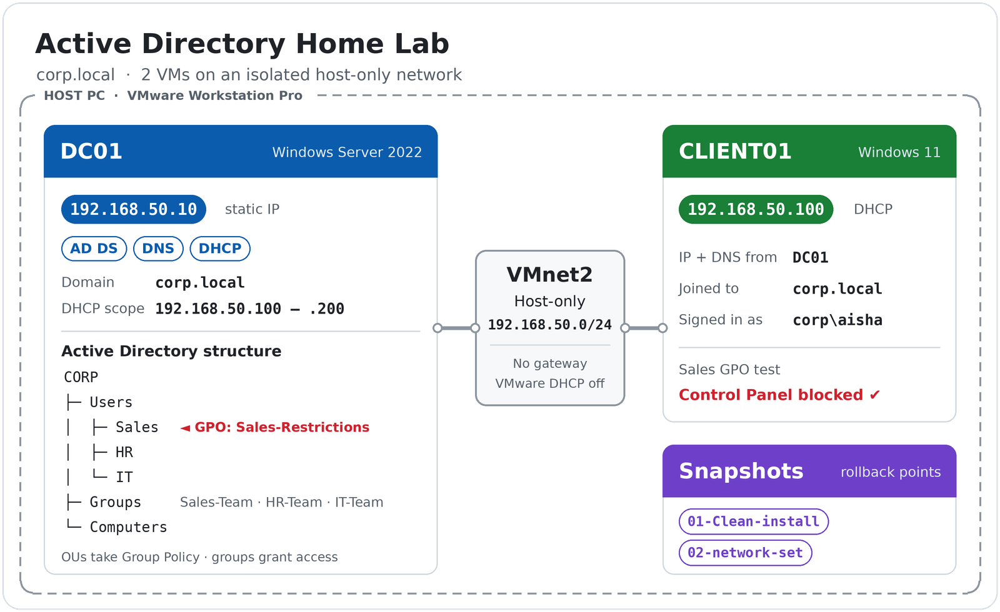

<!-- Add later if you record one:
<h2>Video Demonstration</h2>

- ### [YouTube: Active Directory Home Lab Walkthrough](https://youtu.be/YOUR_VIDEO_ID)
-->

<h2>Skills Demonstrated</h2>

- Building and networking virtual machines (VMware host-only network, static IP, snapshots)
- Installing Active Directory and promoting a domain controller (new forest `corp.local`)
- Setting up and testing DNS and DHCP on Windows Server
- Managing users, security groups and OUs, and joining a PC to the domain
- Creating, linking and testing Group Policy
- Checking my work with command-line tools (`ipconfig`, `ping`, `nslookup`, `dcdiag`, `whoami`)

<h2>Environments and Technologies Used</h2>

- VMware Workstation Pro
- Active Directory Domain Services (AD DS)
- DNS and DHCP (Windows Server roles)
- Group Policy Management

<h2>Operating Systems Used</h2>

- Windows Server 2022 Standard, Desktop Experience (DC01)
- Windows 11 (CLIENT01)

<h2>Lab at a Glance</h2>

| | DC01 | CLIENT01 |
|---|---|---|
| **OS** | Windows Server 2022 | Windows 11 |
| **Role** | Domain controller, DNS, DHCP | Domain-joined user PC |
| **IP address** | 192.168.50.10 (static) | 192.168.50.100 (from DHCP) |
| **Network** | VMnet2: host-only, 192.168.50.0/24, VMware DHCP off | VMnet2 |

**Domain:** `corp.local` &nbsp;·&nbsp; **OUs:** CORP › Users (Sales, HR, IT), Groups, Computers &nbsp;·&nbsp; **Groups:** Sales-Team, HR-Team, IT-Team

<h2>Build Steps</h2>

1. [Build the domain controller](#part-1-build-the-domain-controller) (Steps 1–4)
2. [Network](#part-2-network) (Steps 5–7)
3. [Active Directory](#part-3-active-directory) (Steps 8–10)
4. [Users, groups, DHCP and DNS](#part-4-users-groups-dhcp-and-dns) (Steps 11–13)
5. [The client](#part-5-the-client) (Steps 14–16)
6. [Organise and apply Group Policy](#part-6-organise-and-apply-group-policy) (Steps 17–19)

---

## Part 1: Build the domain controller

### Step 1: Create the DC01 virtual machine

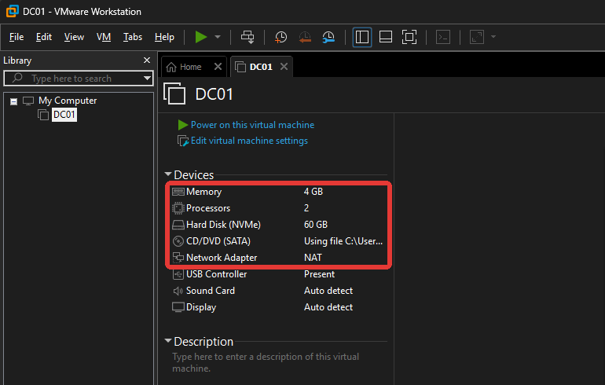

A new VM in VMware with **2 CPUs, 4 GB RAM and a 60 GB disk**, and the Windows Server 2022 ISO attached. The network adapter starts on NAT. I move it to the private lab network in Step 5.

### Step 2: Install Windows Server 2022 and VMware Tools

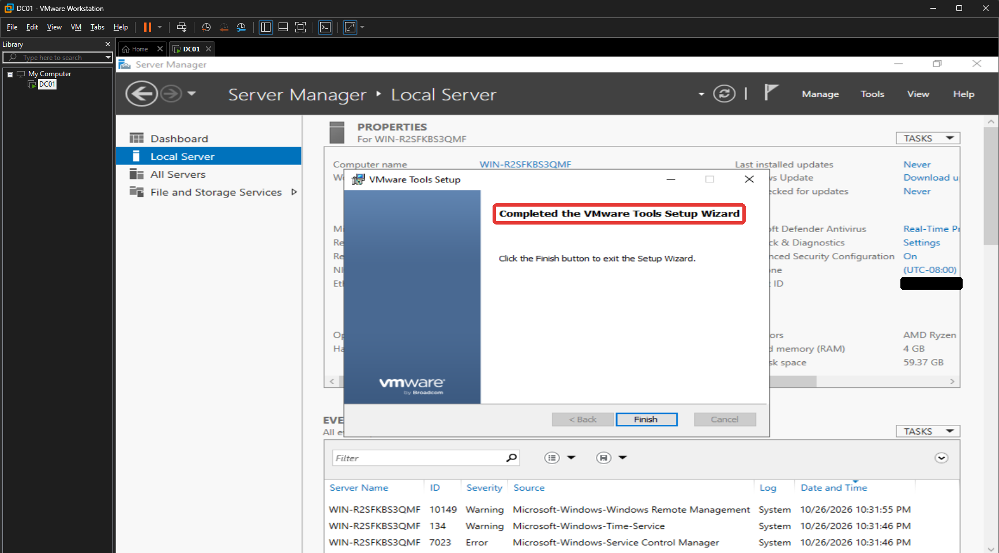

Installed Server 2022 (Standard, Desktop Experience), then VMware Tools so the display, mouse and network drivers work properly.

### Step 3: Rename the server to DC01

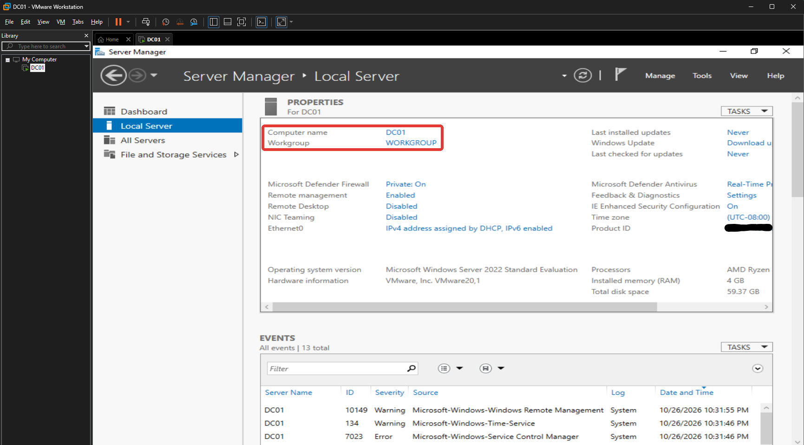

Changed the auto-generated name (WIN-R2SFKBS3QMF) to **DC01** and restarted. The server is still in a workgroup at this point.

### Step 4: Take a snapshot: "01-Clean-install"

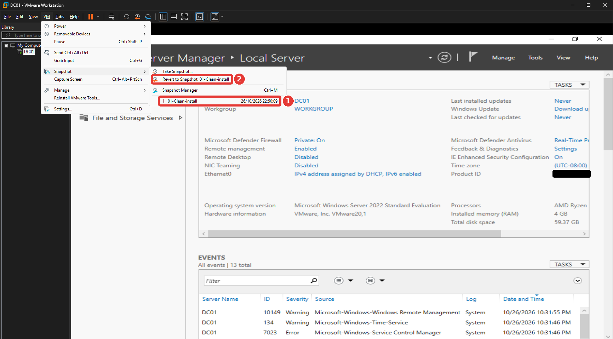

The snapshot **(1)** is a restore point. If a later step goes wrong, I can revert **(2)** instead of reinstalling.

---

## Part 2: Network

### Step 5: Create a private network (VMnet2)

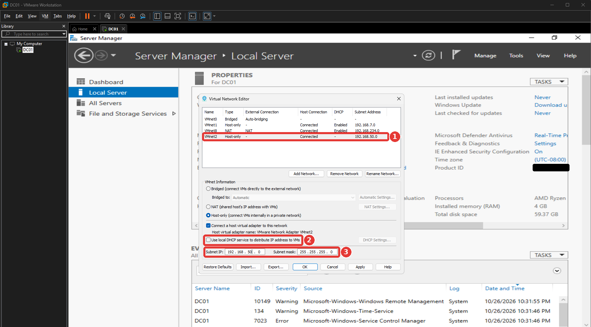

Added **VMnet2** as a host-only network **(1)** and unticked VMware's own DHCP service **(2)**, so DC01 will be the only DHCP server. The subnet is 192.168.50.0 / 255.255.255.0 **(3)**. Then I moved DC01's network adapter onto VMnet2.

### Step 6: Give DC01 a static IP

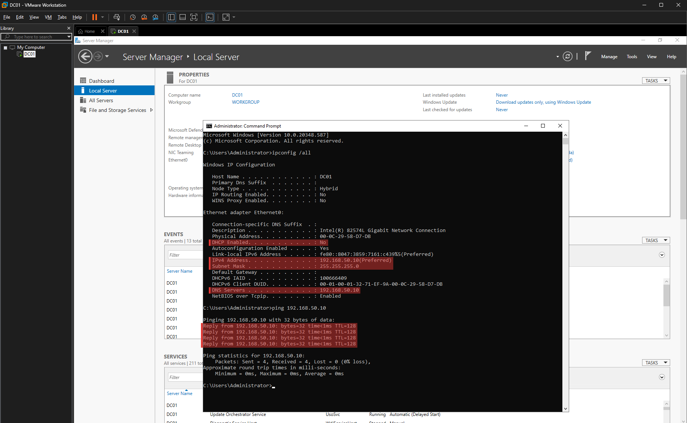

A domain controller needs an address that never changes. `ipconfig /all` shows DHCP is off, the static IP **192.168.50.10** with no gateway (the lab is isolated), and DNS pointing at itself. A `ping` to that address replies, so the adapter works.

### Step 7: Take a snapshot: "02-network-set"

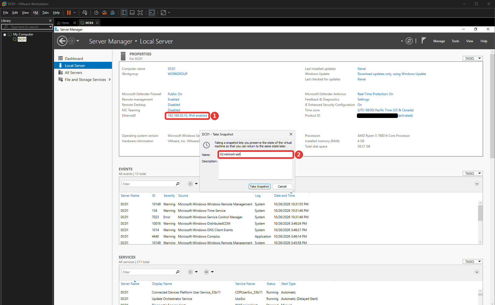

Server Manager now shows the static IP **(1)**. I took a second restore point **(2)** before installing Active Directory.

---

## Part 3: Active Directory

### Step 8: Install AD DS and promote to a domain controller

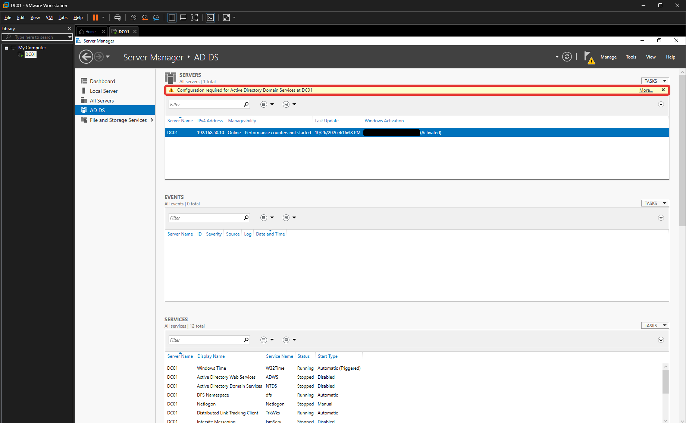

Installed the **Active Directory Domain Services** role (with DNS). The yellow *Configuration required* banner is the prompt to promote the server. I promoted it to a **new forest called `corp.local`**, set a DSRM (recovery) password and restarted.

### Step 9: Check DNS works

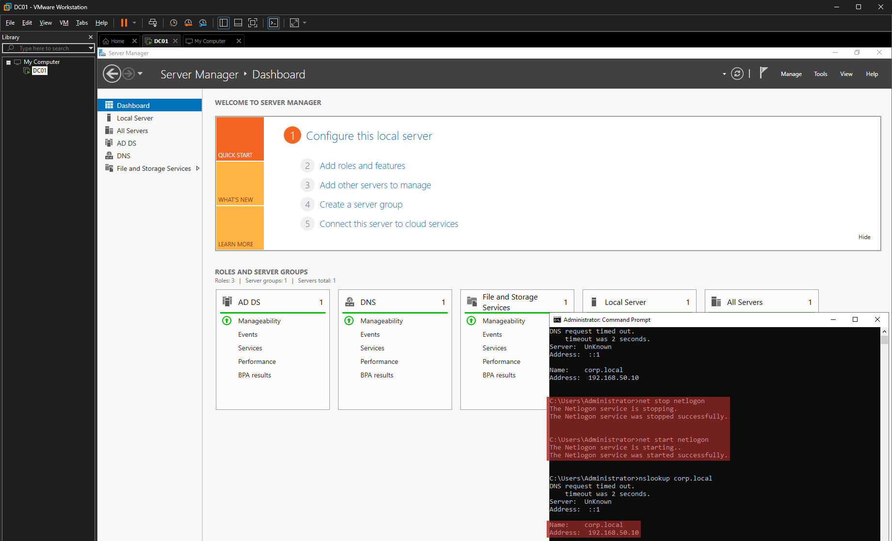

I restarted the Netlogon service so the DC re-registered its DNS records. After that, `nslookup corp.local` returns **192.168.50.10**. The *DNS request timed out / Server: UnKnown* lines only mean the reverse lookup of the DNS server's own address failed, because I didn't create a reverse lookup zone. The answer underneath is correct.

### Step 10: Health check with dcdiag

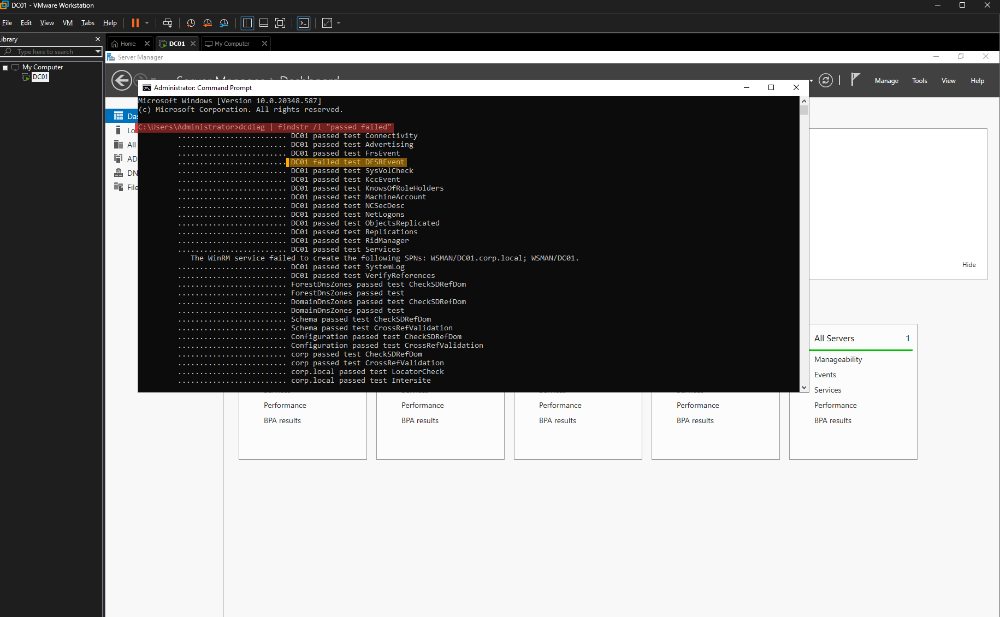

`dcdiag | findstr /i "passed failed"` lists each test. Everything passes except **DFSREvent** (in amber). It flags SYSVOL replication warnings logged just after promotion, which is common on a brand-new lab with only one DC, since there's no second DC to replicate with.

---

## Part 4: Users, groups, DHCP and DNS

### Step 11: Create users and security groups

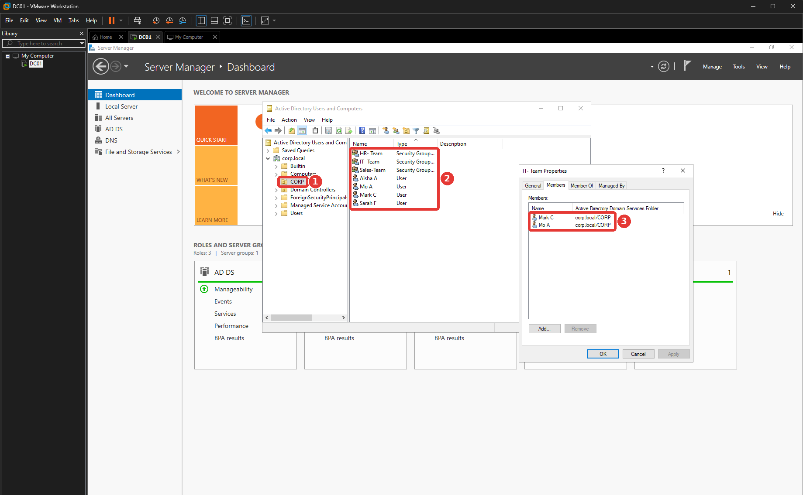

In the **CORP** OU **(1)** I created four test users and three security groups **(2)**, then added members. IT-Team's members are shown **(3)**.

### Step 12: Install DHCP and create a scope

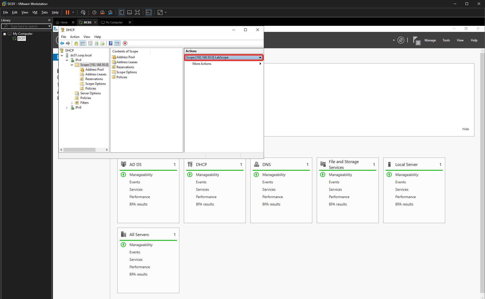

Added the DHCP Server role, authorised it, and created a scope called **LabScope** for the 192.168.50.0 network.

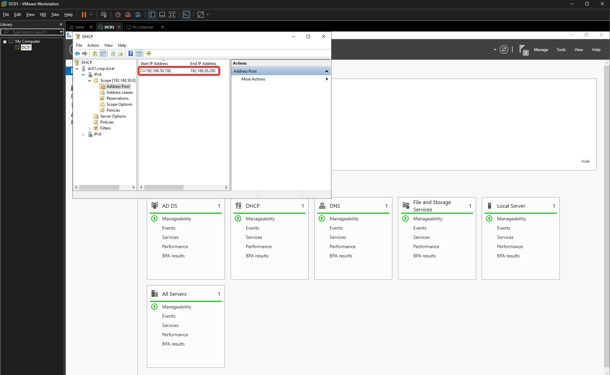

The address pool runs from **192.168.50.100 to 192.168.50.200**. Addresses below .100 stay free for servers like DC01.

### Step 13: Add DNS records

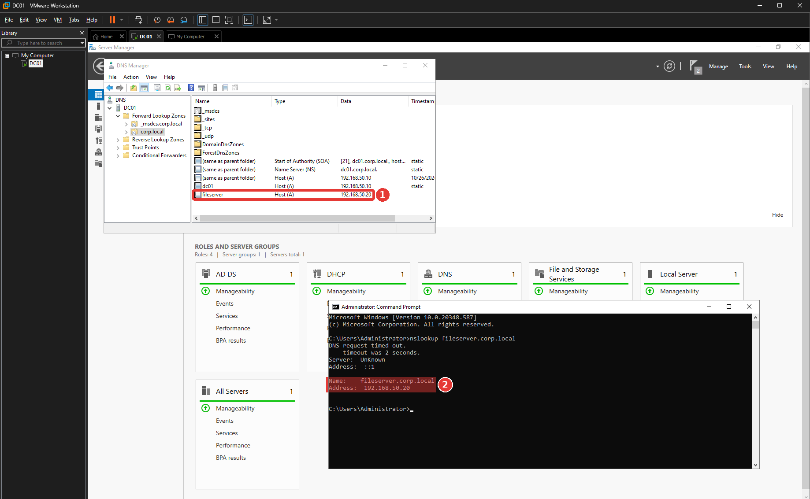

The `corp.local` zone holds DC01's automatic records. I added a test host record, **fileserver → 192.168.50.20 (1)**, and `nslookup fileserver.corp.local` resolves it **(2)**. It's only for practice: nothing exists at .20.

---

## Part 5: The client

### Step 14: CLIENT01 gets an address from DHCP

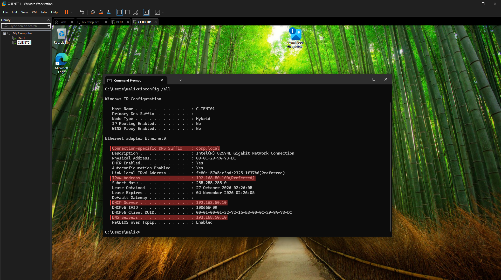

I built a Windows 11 VM on VMnet2. `ipconfig /all` shows the **corp.local** DNS suffix, the address **192.168.50.100** from the scope, and DC01 (192.168.50.10) as both DHCP server and DNS server. That proves DHCP and DNS are working end to end.

### Step 15: Join the domain and sign in as a domain user

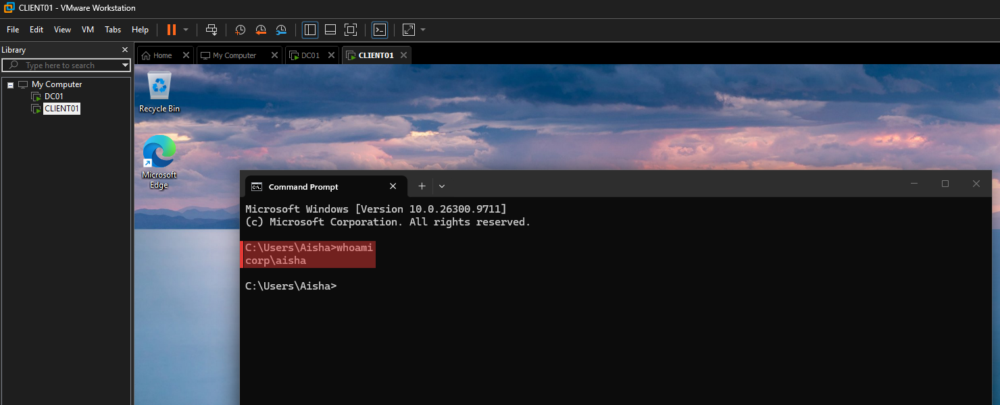

I joined CLIENT01 to `corp.local` (System › Rename this PC (advanced) › Change › Domain), then signed in as Aisha. `whoami` returns **corp\aisha**, so the sign-in was authenticated by the domain controller.

### Step 16: Check the computer account in Active Directory

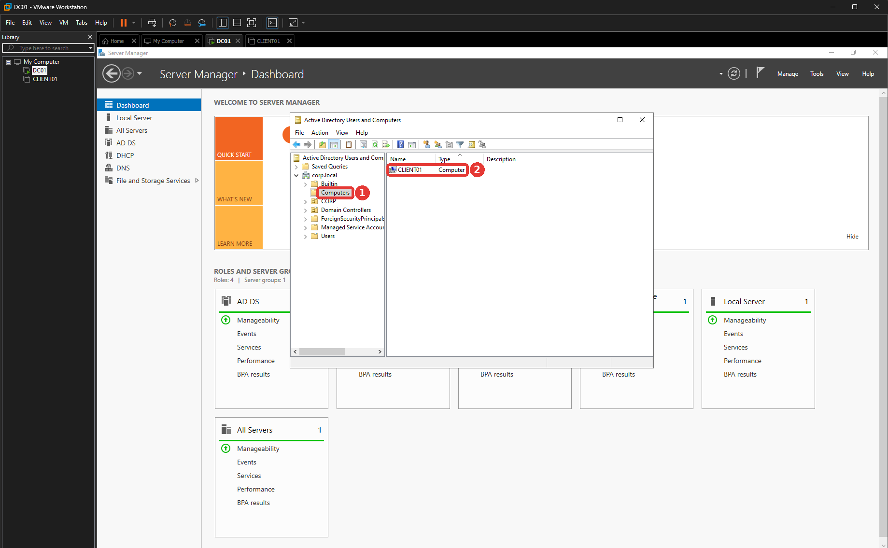

CLIENT01 **(2)** now appears in Active Directory, in the default Computers container **(1)**.

---

## Part 6: Organise and apply Group Policy

### Step 17: Restructure into OUs

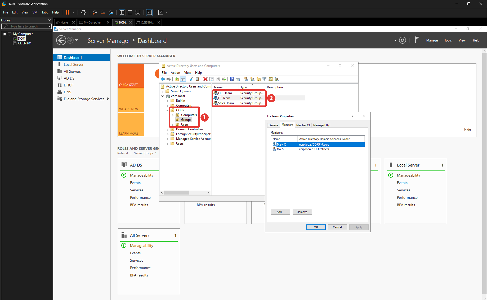

I built an OU tree so policy can be applied by department: **CORP › Users (Sales, HR, IT), Groups and Computers (1)**. The security groups moved into Groups **(2)**, and Sales staff went into the Sales OU so the next policy applies to them. Rule of thumb: Group Policy applies to OUs, while groups are for granting access.

### Step 18: Create and link a Group Policy: "Sales-Restrictions"

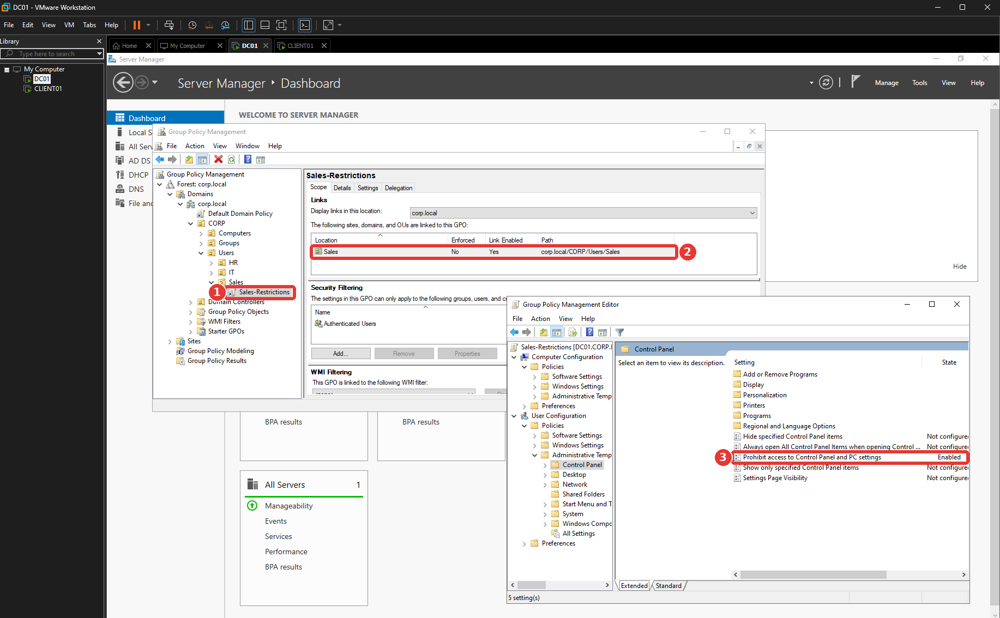

I created the GPO and linked it to the **Sales** OU **(1)(2)**. In the editor I enabled User Configuration › Administrative Templates › Control Panel › **Prohibit access to Control Panel and PC settings (3)**.

### Step 19: Test the policy

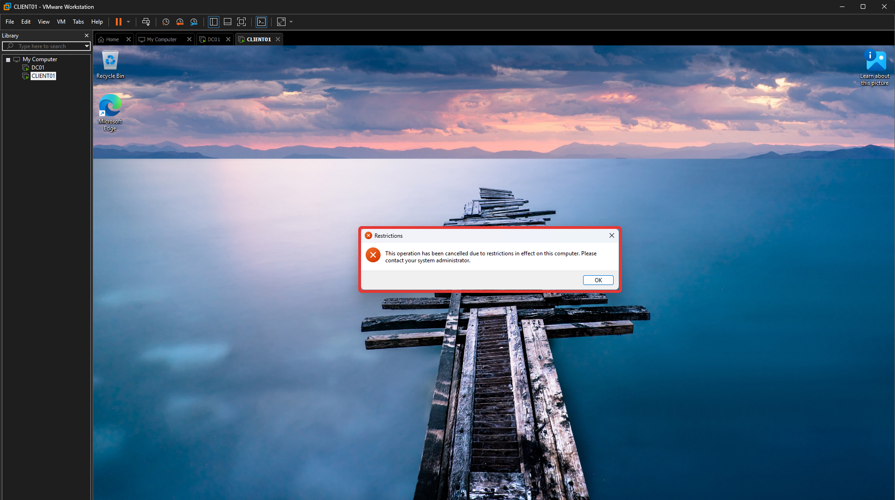

I signed in on CLIENT01 as a Sales user and tried to open Control Panel. Windows blocks it with *"This operation has been cancelled due to restrictions in effect on this computer"*, so the policy works.

---

<h2>Commands Used</h2>

| Command | What it checks |
|---|---|
| `ipconfig /all` | IP address, DHCP and DNS settings (Steps 6 and 14) |
| `ping 192.168.50.10` | The network adapter responds (Step 6) |
| `net stop netlogon` / `net start netlogon` | DC re-registers its DNS records (Step 9) |
| `nslookup corp.local` | DNS resolves names (Steps 9 and 13) |
| `dcdiag` | Domain controller health check (Step 10) |
| `whoami` | Which account is signed in (Step 15) |

<h2>What I Learned</h2>

- **Order matters:** network, then static IP, then AD DS and DNS, then DHCP, then clients.
- A DC needs a **static IP** and must **point at itself for DNS**. Clients get their DNS server from DHCP.
- **OUs take Group Policy; groups grant access.**
- **Snapshots** before big changes saved me from rebuilding when things went wrong.
- **Start DC01 first:** with it switched off, CLIENT01 gets no DHCP lease. That became helpdesk ticket MYH-4.

<h2>Helpdesk Tickets</h2>

I've worked 8 simulated helpdesk tickets in **Jira Service Management** (project MYH) against this lab. Write-ups are being added here, using the same screenshot-and-steps format.

| Scenario | Category | Write-up |
|---|---|---|
| No network after restart (MYH-4) | Networking | 🔜 Coming soon |
| Account lockout | Active Directory | 🔜 Coming soon |
| Password reset | Active Directory | 🔜 Coming soon |
| Trust relationship failure | Active Directory | 🔜 Coming soon |
| Group Policy not applying | Group Policy | 🔜 Coming soon |
| Folder sharing / permissions | File Services | 🔜 Coming soon |
| New starter setup | User Lifecycle | 🔜 Coming soon |
| Leaver offboarding | User Lifecycle | 🔜 Coming soon |
