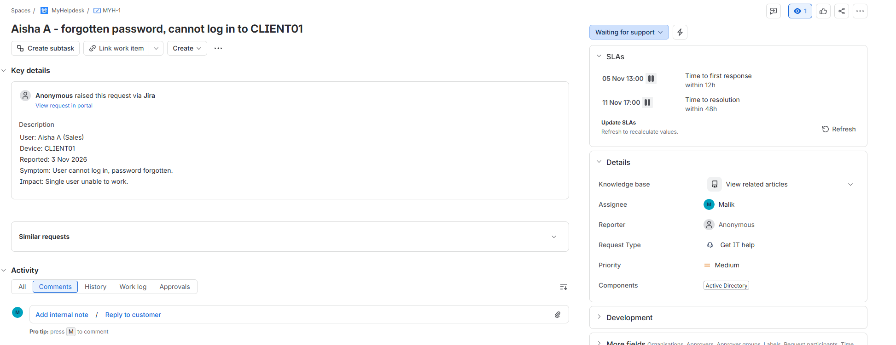
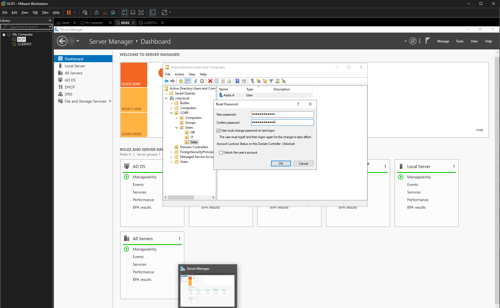
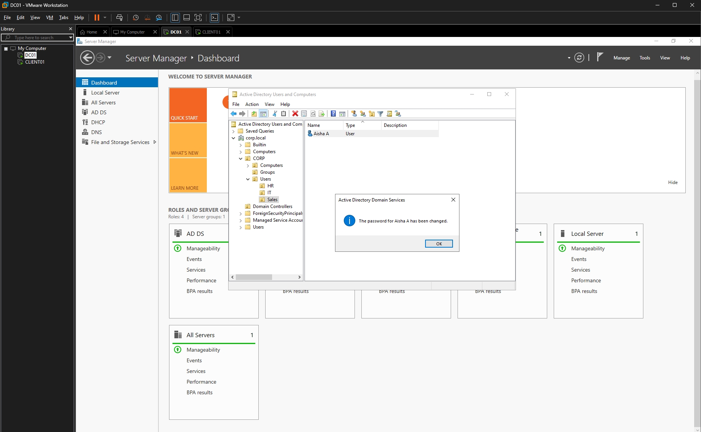
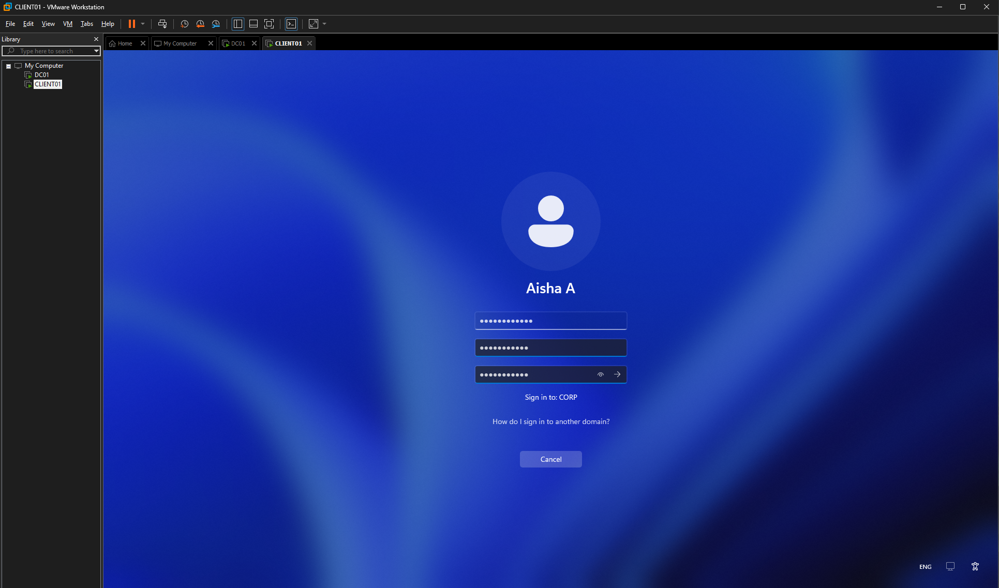
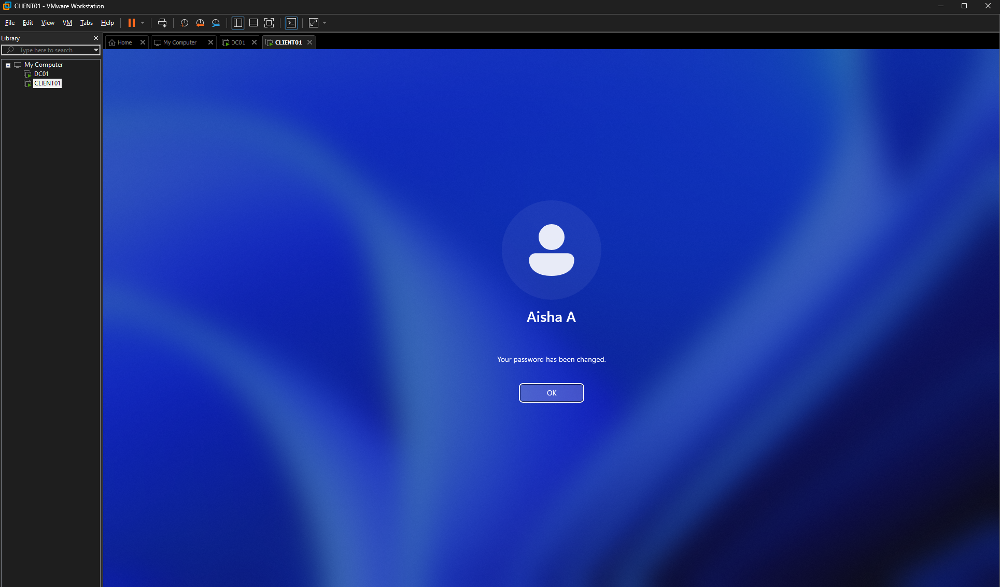
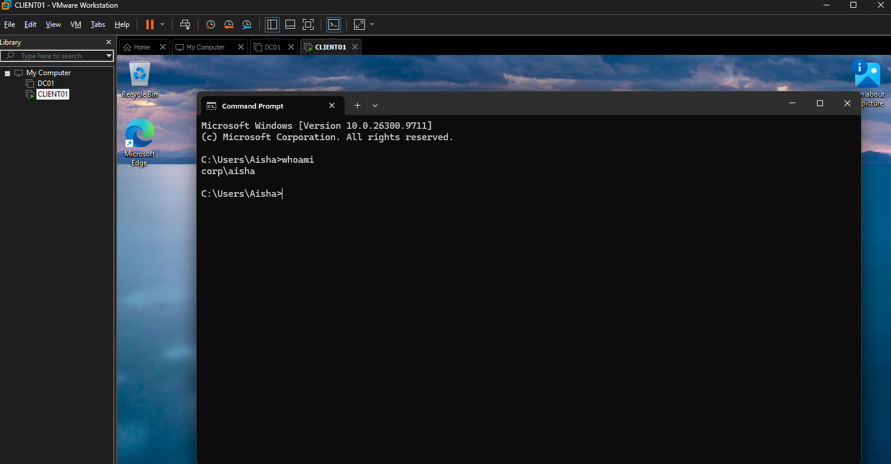
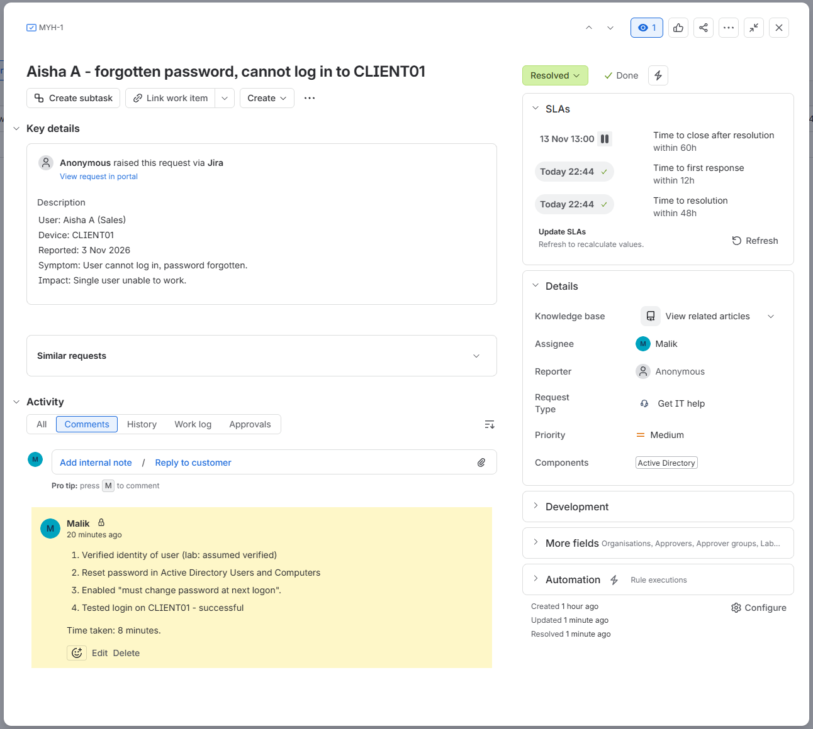

# MYH-1: Aisha A - forgotten password, cannot log in to CLIENT01

**Type:** Account / Active Directory | **Priority:** Medium | **Component:** Active Directory | **Time taken:** 8 minutes | **Status:** Resolved (Done)

**Environment:** VMware home lab, domain `corp.local`. DC01 (Windows Server 2022) and CLIENT01 (Windows 11).

## The report
User: Aisha A (Sales). Device: CLIENT01. Reported: 3 Nov 2026. Symptom: user cannot log in, password forgotten. Impact: single user unable to work.

 Ticket as raised

## Diagnosis
Verified the user's identity (lab: assumed verified). In a real environment this means a security question, a call-back or manager approval before any reset.

## Fix
**1. Reset the password.** On DC01, Active Directory Users and Computers > CORP > Users > Sales > Aisha A > Reset Password. Set a temporary password and ticked **User must change password at next logon**. The dialog shows the account as Unlocked, so "Unlock the user's account" was not needed.

 AD Reset Password dialog

 Confirmation: password changed

**2. First sign-in.** On CLIENT01, Aisha signs in to CORP with the temporary password and is prompted to set a new one.

 CLIENT01 forced password change

 Password changed message

## Verification
Windows confirmed "Your password has been changed" on CLIENT01 and the login was successful. Signing in as Aisha afterwards, `whoami` returns `corp\aisha`, so the domain authenticated her with the new password.

 whoami as Aisha

## Resolution
Closed as Resolved / Done with an internal note.

 Resolved ticket

> **Internal note:** 1. Verified identity of user (lab: assumed verified). 2. Reset password in Active Directory Users and Computers. 3. Enabled "must change password at next logon". 4. Tested login on CLIENT01 - successful. Time taken: 8 minutes.

## What I learned
- Always verify identity before a reset.
- A temporary password plus "must change at next logon" means only the user knows the final password.
- Check whether the account is also locked out. The reset dialog shows the lockout status.

---

<a href="../README.md#helpdesk-tickets">All tickets</a> &nbsp;·&nbsp; <a href="MYH-2_new-starter.md">MYH-2: New starter →</a>

