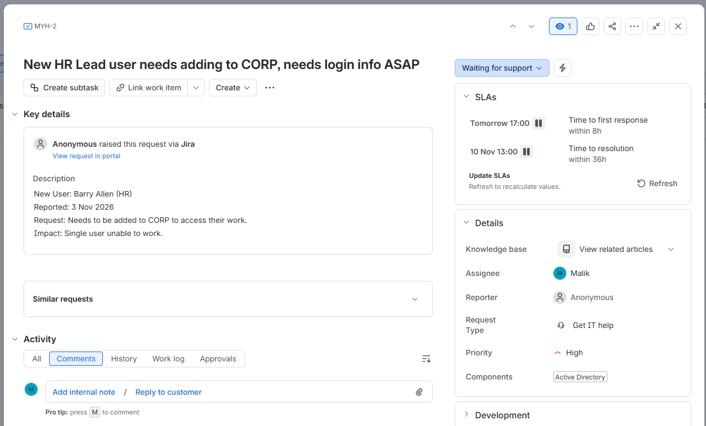
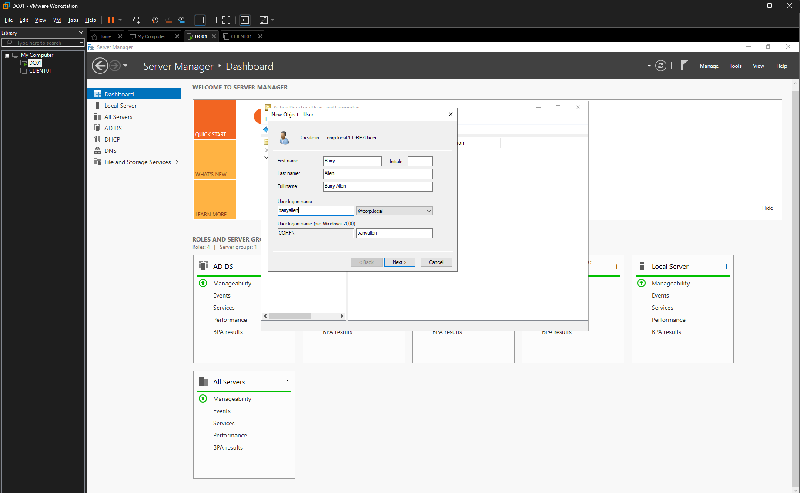
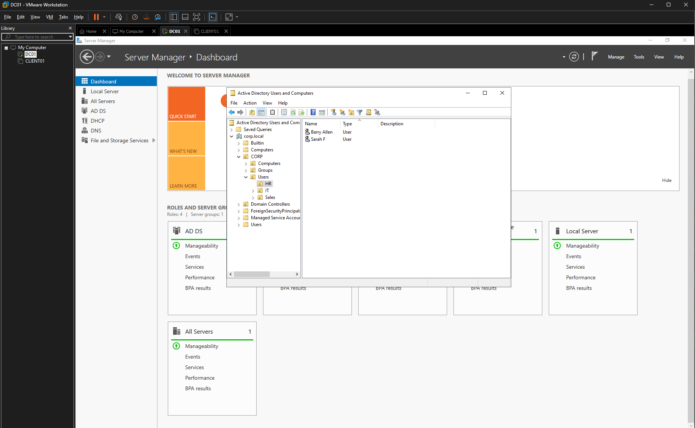
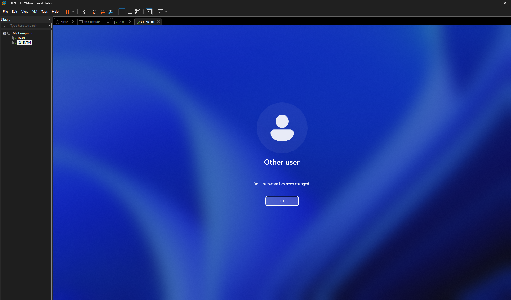
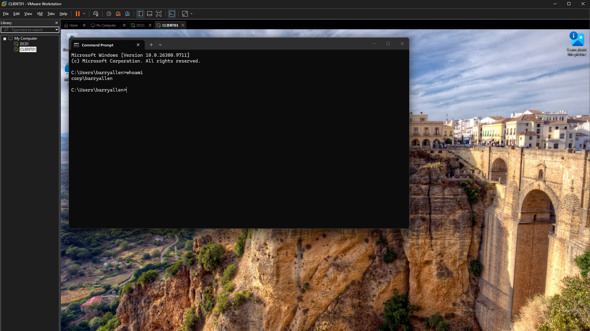
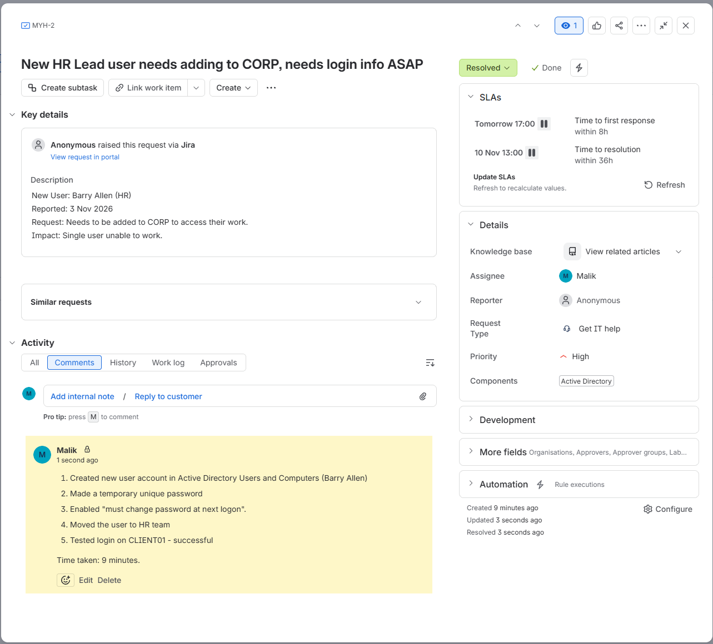

# MYH-2: New HR Lead user needs adding to CORP, needs login info ASAP

**Type:** Account creation / Active Directory | **Priority:** High | **Component:** Active Directory | **Time taken:** 9 minutes | **Status:** Resolved (Done)

**Environment:** VMware home lab, domain `corp.local`. DC01 (Windows Server 2022) and CLIENT01 (Windows 11).

## The report
New user: Barry Allen (HR). Reported 3 Nov 2026. He needs to be added to CORP to access his work. Impact: single user unable to work.

 Ticket as raised

## Diagnosis
Nothing is broken. This is a standard new-starter request, so the work is creating the account, making sure it is secure, and putting it in the right place in AD.

## Fix
**1. Create the account.** On DC01, Active Directory Users and Computers > CORP > Users > New > User. First name Barry, last name Allen, logon name `barryallen` (@corp.local).

 New user wizard

 User details filled in

**2. Set a temporary password and force a change.** The confirmation screen shows "The user must change the password at next logon", then Finish.

 Confirmation screen

**3. Place the user in HR.** Moved the user into the HR team (see the internal note below).

 Barry Allen in the HR OU (screenshot from MYH-5)

## Verification
On CLIENT01, Barry signs in with the temporary password and is forced to set a new one ("Your password has been changed").

 CLIENT01 password change

`whoami` returns `corp\barryallen`, so the domain account works.

 whoami as corp\barryallen

## Resolution
Closed as Resolved / Done with an internal note.

 Resolved ticket

> **Internal note:** 1. Created new user account in Active Directory Users and Computers (Barry Allen). 2. Made a temporary unique password. 3. Enabled "must change password at next logon". 4. Moved the user to HR team. 5. Tested login on CLIENT01 - successful. Time taken: 9 minutes.

## What I learned
- New accounts get a temporary password and a forced change, so only the user knows the final password.
- Use a consistent naming format (first name + last name) for logon names.
- Placement matters: the OU decides which policies apply, the group decides what the user can access.

---

<a href="MYH-1_password-reset.md">← MYH-1: Password reset</a> &nbsp;·&nbsp; <a href="../README.md#helpdesk-tickets">All tickets</a> &nbsp;·&nbsp; <a href="MYH-3_trust-relationship-failure.md">MYH-3: Trust relationship failure →</a>

