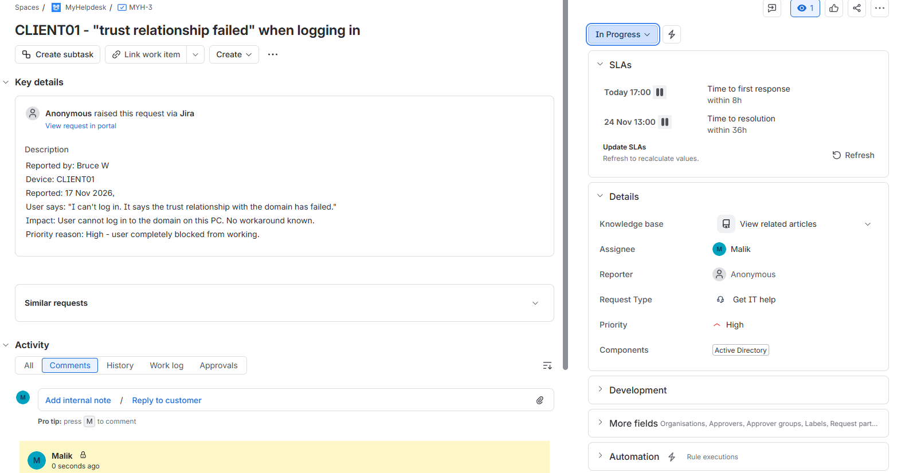
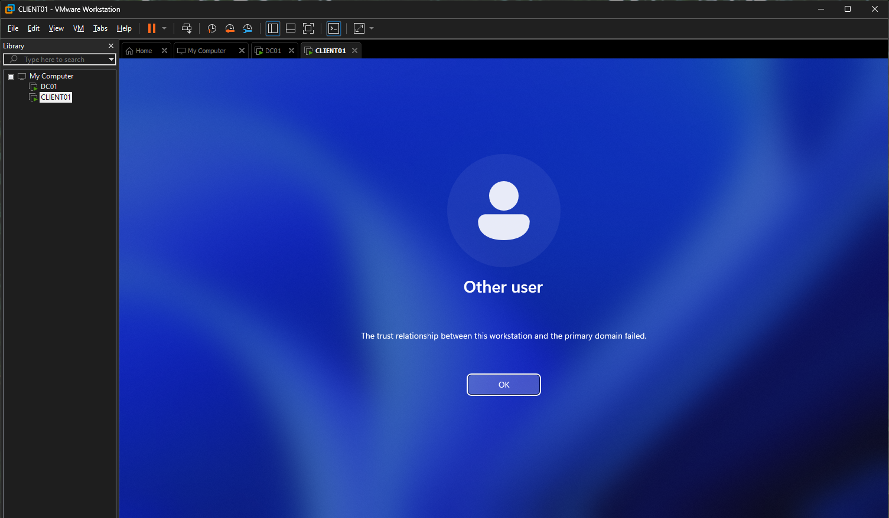
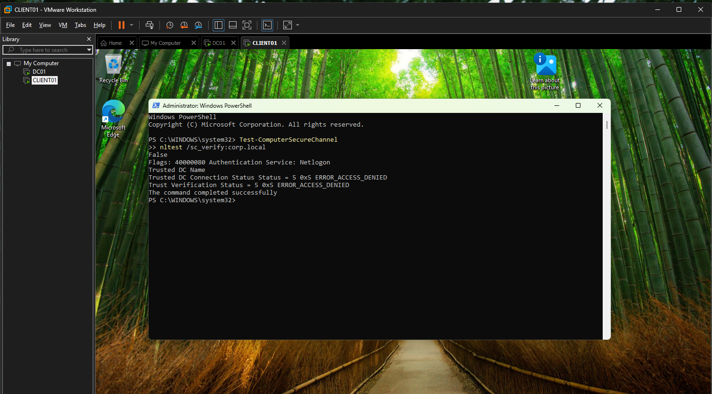
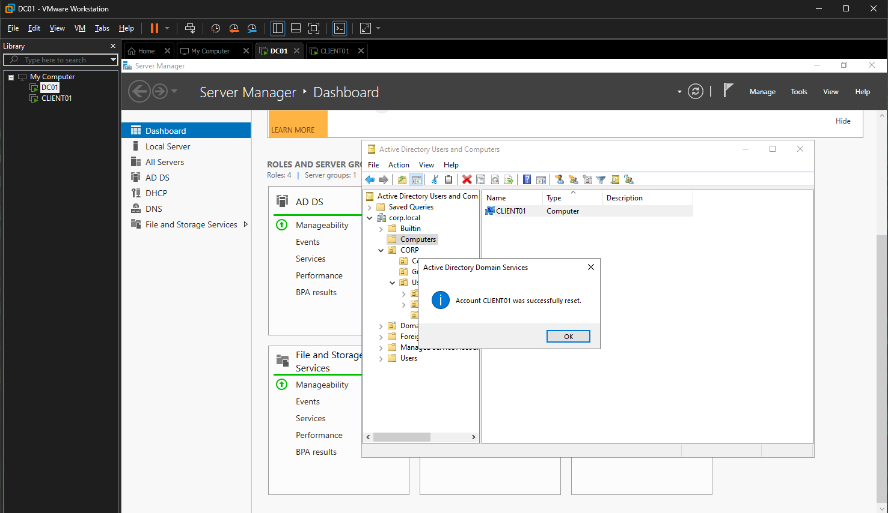
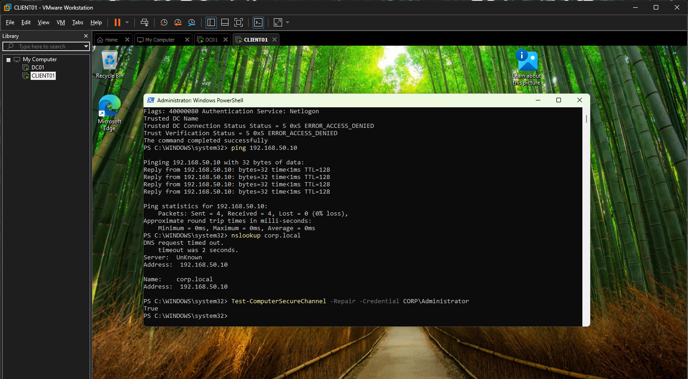
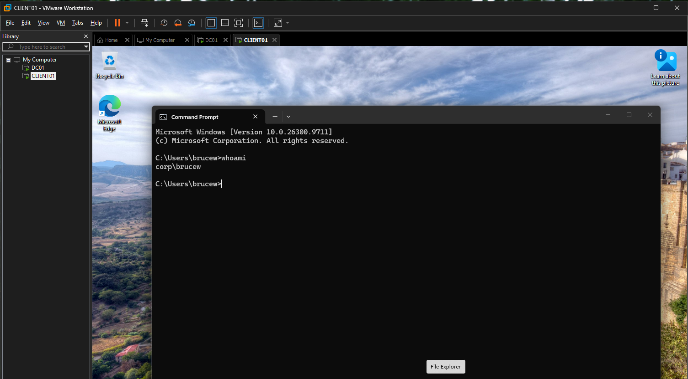
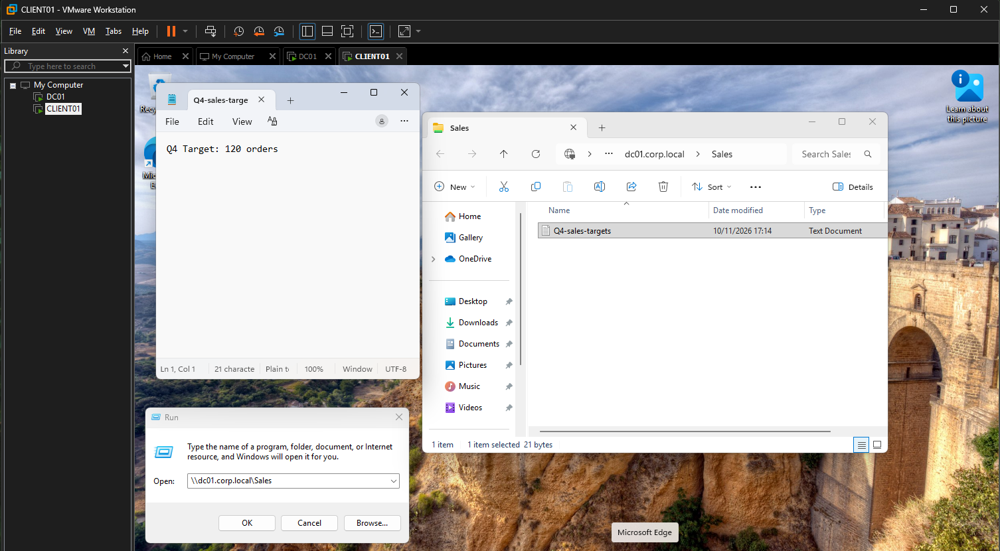
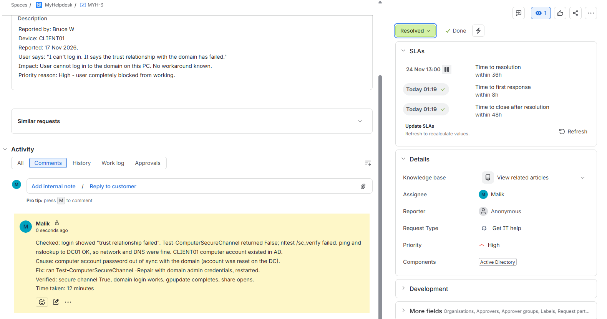

# MYH-3: CLIENT01 "trust relationship failed" when logging in

**Type:** Active Directory / Authentication | **Priority:** High | **Time taken:** 12 minutes | **Status:** Resolved (Done)

**Environment:** VMware home lab, domain `corp.local`. DC01 (Windows Server 2022) and CLIENT01 (Windows 11).

## The report
Bruce W says: *"I can't log in. It says the trust relationship with the domain has failed."* One user affected, completely blocked from working on this PC, with no workaround. Priority High.

<p align="center">

<br/><sub>Ticket as raised</sub>
</p>

The user sees this message at the sign-in screen:

<p align="center">

<br/><sub>Trust relationship error at sign-in</sub>
</p>

## Diagnosis

**1. Confirm the secure channel is broken.** Signed in to CLIENT01 with a local administrator account and ran `Test-ComputerSecureChannel` in an elevated PowerShell. It returned **False**. `nltest /sc_verify:corp.local` then showed the trusted DC connection and trust verification both failing with **status 5, ERROR_ACCESS_DENIED**. That means the PC reached the domain but the domain refused the machine's credentials.

<p align="center">

<br/><sub>Test-ComputerSecureChannel False and nltest ACCESS_DENIED</sub>
</p>

**2. Rule out network and DNS.** `ping 192.168.50.10` returned 4 replies, 0% loss, and `nslookup corp.local` resolved to 192.168.50.10. (The "DNS request timed out / Server: UnKnown" line is the same cosmetic reverse-lookup failure as in the AD build, because there is no reverse zone. The forward answer underneath is correct.) The network is fine, so this is an identity problem, not a connectivity one.

**3. Check the computer account in AD.** CLIENT01 still exists in Active Directory, so the account was there but its password no longer matched the one held on the PC.

## Cause
The CLIENT01 computer account password was out of sync with the domain. In this simulation I caused it by resetting the CLIENT01 account on DC01 (Active Directory Users and Computers > right-click the computer > Reset Account). Windows computer accounts have their own password that the PC and the DC rotate automatically. When the two copies differ, the PC cannot authenticate to the domain and shows this error. In real life the usual causes are restoring an old snapshot or backup, a long-offline machine, or a re-imaged PC reusing the name.

<p align="center">

<br/><sub>Computer account reset on DC01</sub>
</p>

## Fix
Repaired the secure channel from CLIENT01 with domain admin credentials, without rejoining the domain:

```powershell
Test-ComputerSecureChannel -Repair -Credential CORP\Administrator
```

It returned **True**.

<p align="center">

<br/><sub>Repair command returns True</sub>
</p>

## Verification
- Bruce W signed in with his domain account. `whoami` returns `corp\brucew`.

<p align="center">

<br/><sub>Domain login as corp\brucew</sub>
</p>

- `Test-ComputerSecureChannel` now returns **True**, and `gpupdate /force` starts and reports "Computer Policy update has completed successfully."

<p align="center">

<br/><sub>Secure channel True and gpupdate</sub>
</p>

- Opened the Sales share with `\\dc01.corp.local\Sales` from the Run box. It opened, and he could open `Q4-sales-targets` in Notepad, so domain authentication and share access both work again.

<p align="center">

<br/><sub>Sales share opens</sub>
</p>

## Resolution
Closed as Resolved / Done with an internal note.

<p align="center">

<br/><sub>Resolved ticket</sub>
</p>

> **Internal note:** Checked: login showed "trust relationship failed". Test-ComputerSecureChannel returned False; nltest /sc_verify failed. ping and nslookup to DC01 OK, so network and DNS were fine. CLIENT01 computer account existed in AD. Cause: computer account password out of sync with the domain (account was reset on the DC). Fix: ran Test-ComputerSecureChannel -Repair with domain admin credentials, restarted. Verified: secure channel True, domain login works, gpupdate completes, share opens. Time taken: 12 minutes

## What I learned
- "Trust relationship failed" is a computer-account problem, not a user-password problem. Resetting the user's password would not have helped.
- Check the network and DNS first (ping, nslookup). If they work, the fault is authentication.
- `Test-ComputerSecureChannel -Repair` fixes it in one line and avoids the slower route of removing the PC from the domain and rejoining it (which also needs the old computer account reset or deleted).
- You need a local administrator account to get in, because the domain login is exactly what is broken. A real helpdesk keeps a local admin for this reason.

---

<p align="center">
<a href="MYH-2_new-starter.md">← MYH-2: New starter</a> &nbsp;·&nbsp; <a href="../README.md#helpdesk-tickets">All tickets</a> &nbsp;·&nbsp; <a href="MYH-4_no-network-after-restart.md">MYH-4: No network after restart →</a>
</p>
