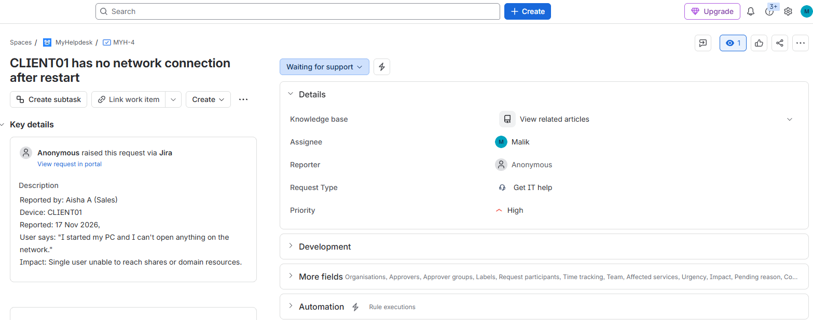
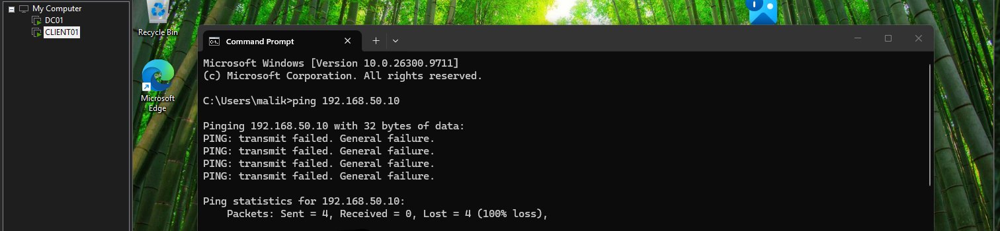
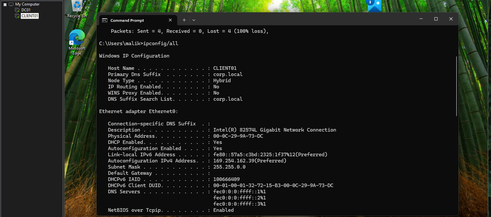
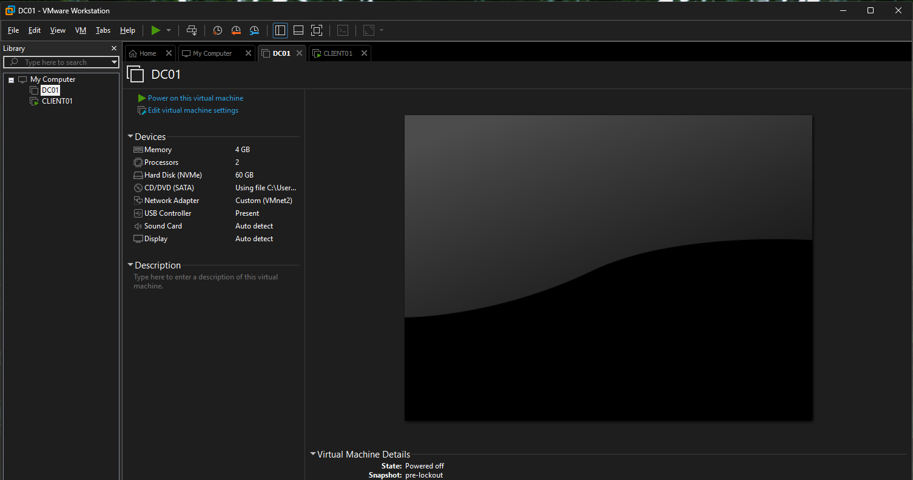
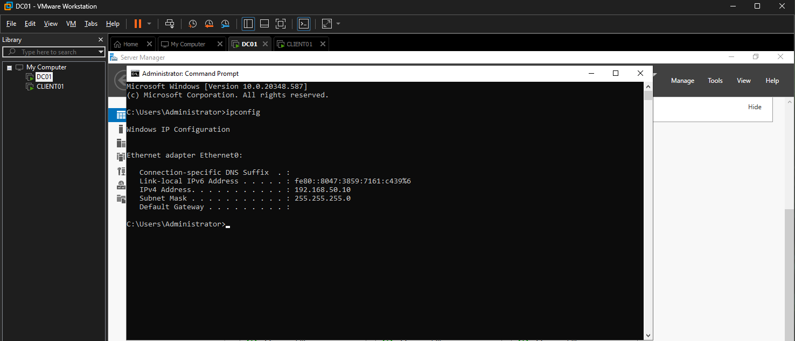
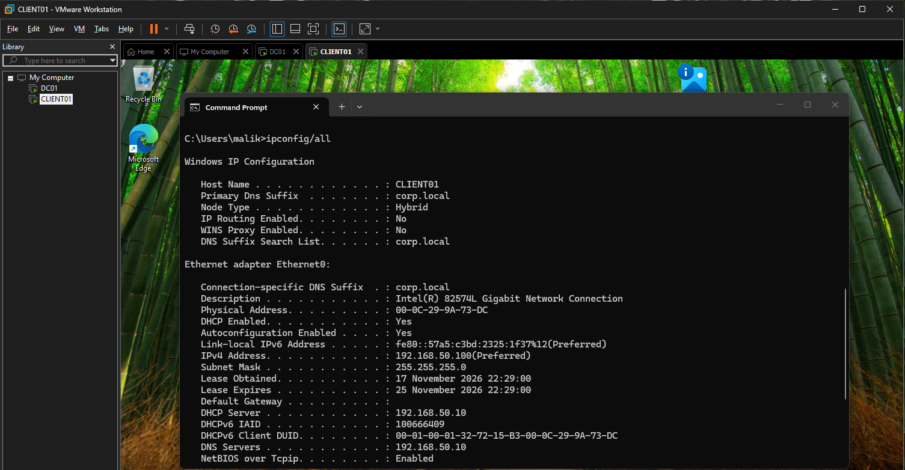
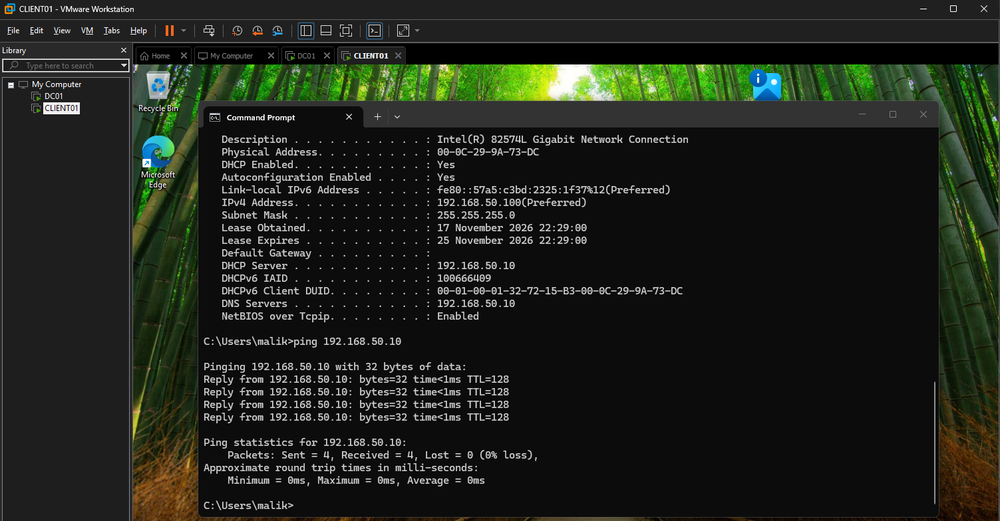
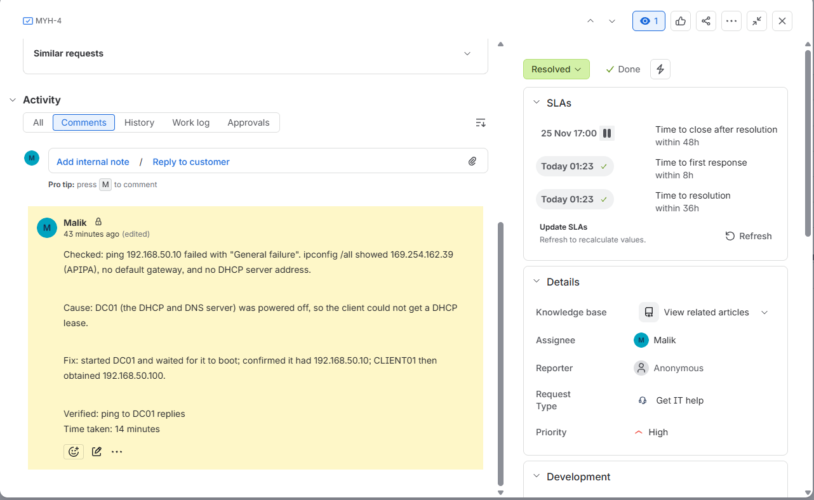

# MYH-4: CLIENT01 has no network connection after restart

**Type:** Network / DHCP | **Priority:** High | **Time taken:** 14 minutes | **Status:** Resolved

**Environment:** VMware home lab, domain `corp.local`. DC01 (Windows Server 2022, DHCP + DNS) and CLIENT01 (Windows 11).

## The report
Aisha A (Sales) says: *"I started my PC and I can't open anything on the network."* One user affected, unable to reach shares or domain resources.

 Ticket as raised

## Diagnosis

**1. Test basic connectivity.** From CLIENT01, `ping 192.168.50.10` (the DC) failed with "General failure". That error means the PC has no usable network configuration. It is different from "Request timed out", which would mean the network works but nothing replied.

 Ping General failure

**2. Check the IP configuration.** `ipconfig /all` showed an address of **169.254.162.39** (APIPA), no default gateway and no DHCP server. A 169.254.x.x address means the client asked for an address and nobody answered.

 ipconfig showing APIPA

**3. Check the server that should answer.** In VMware, DC01 was **Powered off**. DC01 runs DHCP and DNS for the lab, so this was the likely cause.

 DC01 powered off

## Cause
DC01 (the DHCP and DNS server) was powered off, so CLIENT01 could not get a DHCP lease and fell back to an APIPA address.

## Fix
Started DC01 and waited for it to finish booting. Confirmed on DC01 that it had its static address, 192.168.50.10.

 DC01 IP after boot

CLIENT01 then obtained a lease from DC01 (192.168.50.100).

 CLIENT01 lease

## Verification
`ping 192.168.50.10` from CLIENT01 returned 4 replies, 0% loss.

 Ping success

## Resolution
Documented and closed in Jira Service Management with the internal note below.

 Resolved ticket

> **Internal note:** Checked: ping 192.168.50.10 failed with "General failure". ipconfig /all showed 169.254.162.39 (APIPA), no default gateway, and no DHCP server address. Cause: DC01 (the DHCP and DNS server) was powered off, so the client could not get a DHCP lease. Fix: started DC01 and waited for it to boot; confirmed it had 192.168.50.10; CLIENT01 then obtained 192.168.50.100. Verified: ping to DC01 replies. Time taken: 14 minutes

## What I learned
- A 169.254.x.x address on a domain PC means DHCP did not answer. Check the DHCP server before touching the client.
- "General failure" and "Request timed out" mean different things, and telling them apart narrows the fault quickly.
- In the lab, start DC01 first and shut it down last. In a real environment this is the "server is down, so everyone's PC loses the network" case.

---

<a href="MYH-3_trust-relationship-failure.md">← MYH-3: Trust relationship failure</a> &nbsp;·&nbsp; <a href="../README.md#helpdesk-tickets">All tickets</a> &nbsp;·&nbsp; <a href="MYH-5_restrict-command-prompt-hr.md">MYH-5: Restrict Command Prompt for HR (GPO) →</a>

