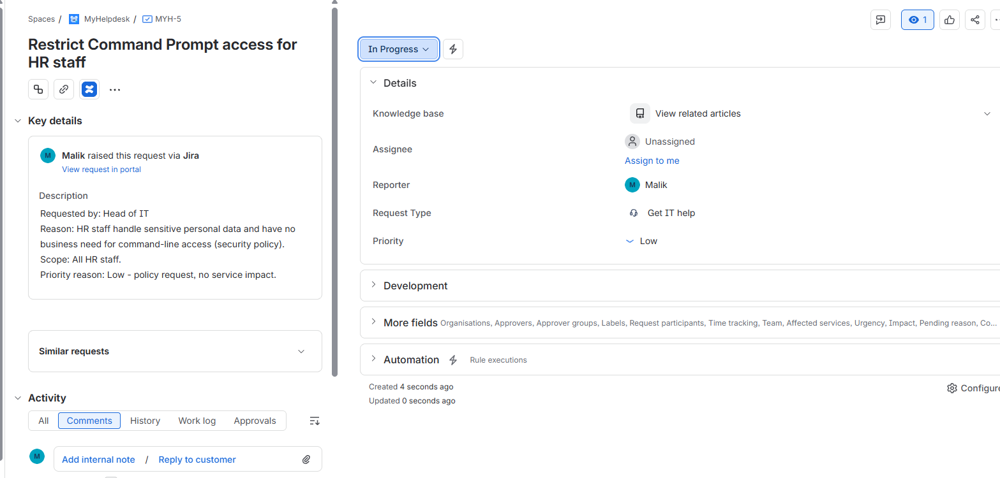
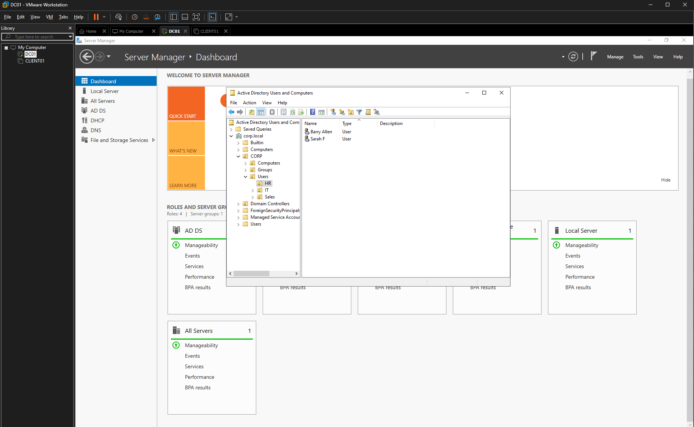
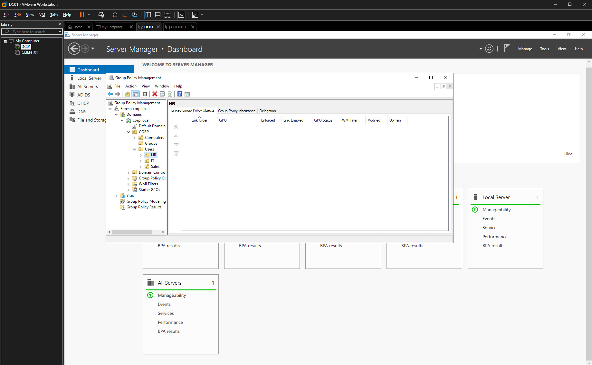
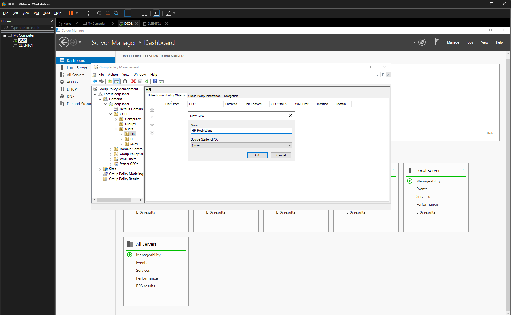
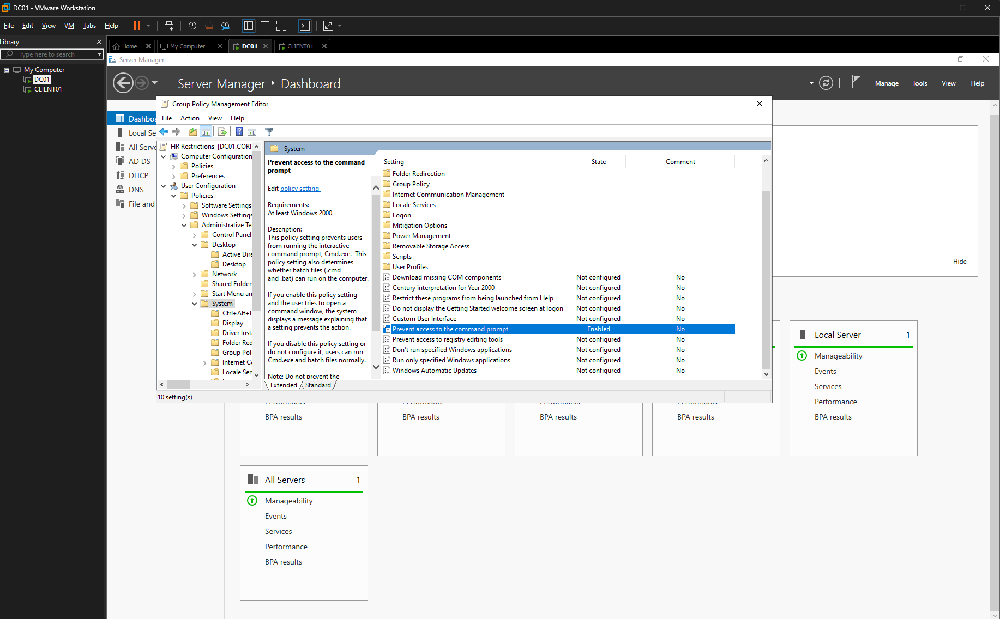
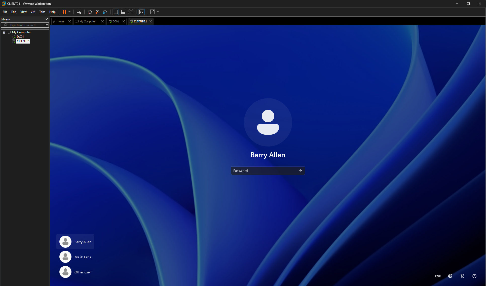
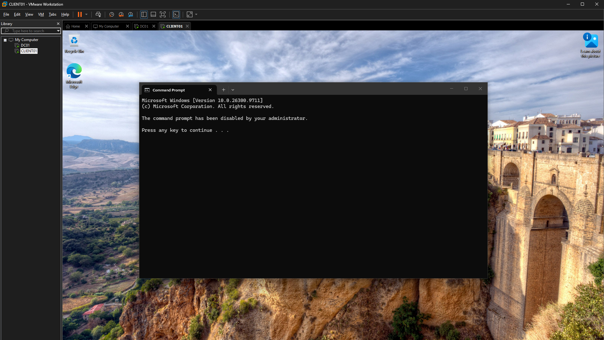
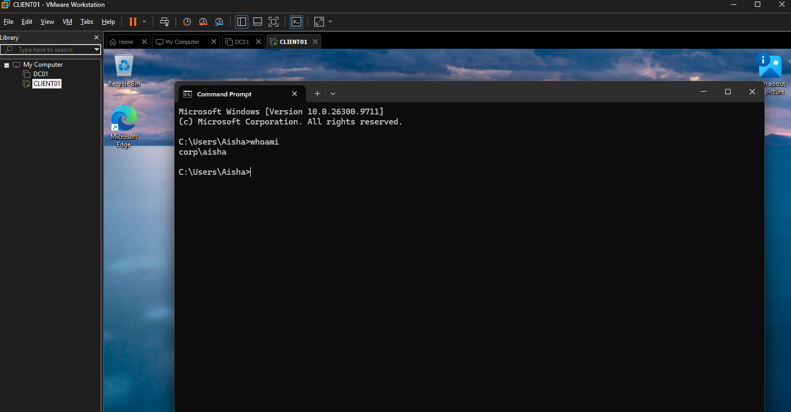
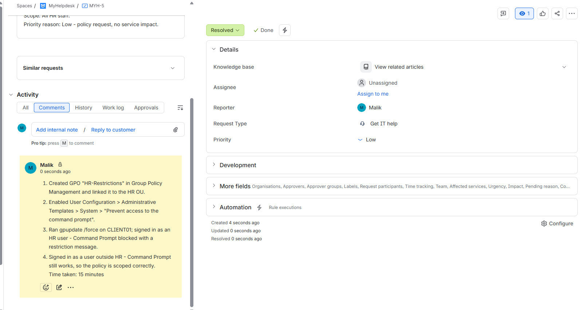

# MYH-5: Restrict Command Prompt access for HR staff

**Type:** Policy request / Group Policy | **Priority:** Low | **Time taken:** 15 minutes | **Status:** Resolved (Done)

**Environment:** VMware home lab, domain `corp.local`. DC01 (Windows Server 2022) and CLIENT01 (Windows 11).

## The report
Requested by the Head of IT. HR staff handle sensitive personal data and have no business need for command-line access (security policy). Scope: all HR staff. Priority is Low because it is a policy request with no service impact.

 Ticket as raised

## Diagnosis
Nothing is broken. This is a least-privilege request. The right tool is a Group Policy Object (GPO) linked to the **HR OU**, because policies apply to OUs, not groups. The HR OU already holds the HR users (Barry Allen and Sarah F), and the OU has no GPOs linked yet.

 HR OU members

 HR OU with no linked GPOs

## Fix
**1. Create the GPO.** In Group Policy Management, with the HR OU selected, create a new GPO named "HR Restrictions".

 New GPO

**2. Enable the setting.** Edit the GPO: User Configuration > Policies > Administrative Templates > System > **Prevent access to the command prompt** = **Enabled**.

 Prevent access to the command prompt: Enabled

## Verification
On CLIENT01, sign in as an HR user (Barry Allen).

 CLIENT01 sign-in as Barry Allen

Opening Command Prompt now shows "The command prompt has been disabled by your administrator." Earlier, when he was set up (MYH-2), the same account could run `whoami` in Command Prompt, so this is a before-and-after.

 Command prompt blocked

**Control test.** A user outside HR is not affected. Aisha A (Sales) opens Command Prompt and runs `whoami` normally (`corp\aisha`), because the GPO is linked only to the HR OU.

 Aisha (Sales) can still use Command Prompt

## Resolution
Closed as Resolved / Done with an internal note.

 Resolved ticket

> **Internal note:** 1. Created GPO "HR-Restrictions" in Group Policy Management and linked it to the HR OU. 2. Enabled User Configuration > Administrative Templates > System > "Prevent access to the command prompt". 3. Ran gpupdate /force on CLIENT01; signed in as an HR user - Command Prompt blocked with a restriction message. 4. Signed in as a user outside HR - Command Prompt still works, so the policy is scoped correctly. Time taken: 15 minutes

*Correction: the GPO is named "HR Restrictions" (no hyphen), as the screenshots above show. The hyphen in the note is a typo.*

## What I learned
- Policies attach to OUs. Groups grant access, OUs take policy. That is why the HR users had to be in the HR OU.
- Always test both sides: an affected user is blocked, and an unaffected user is not.
- Least privilege: remove tools users don't need, and record who asked for the change and why.

---

<a href="MYH-4_no-network-after-restart.md">← MYH-4: No network after restart</a> &nbsp;·&nbsp; <a href="../README.md#helpdesk-tickets">All tickets</a> &nbsp;·&nbsp; <a href="MYH-6_account-lockout.md">MYH-6: Account lockout →</a>

