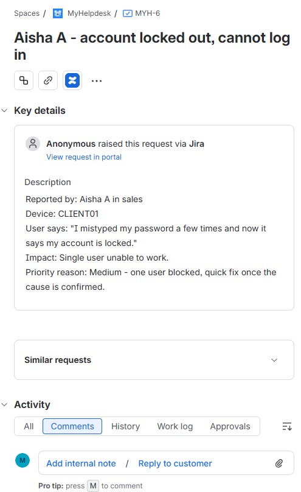
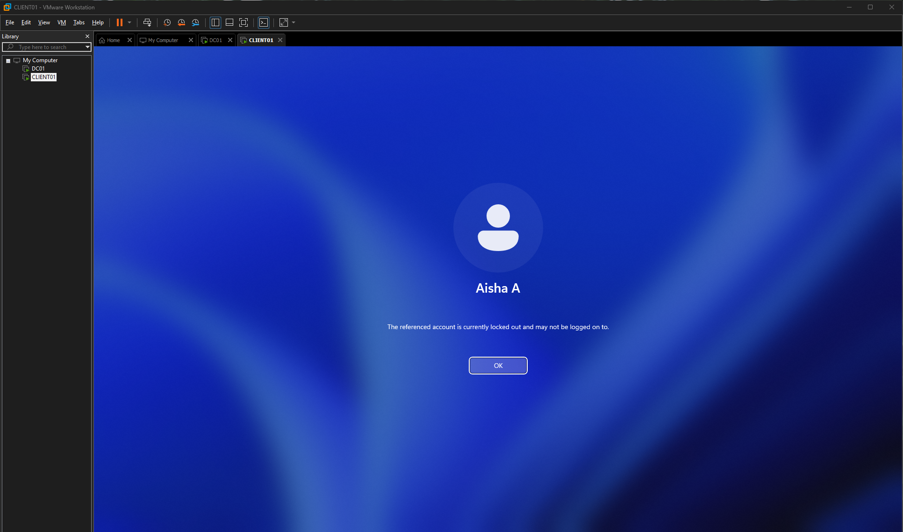
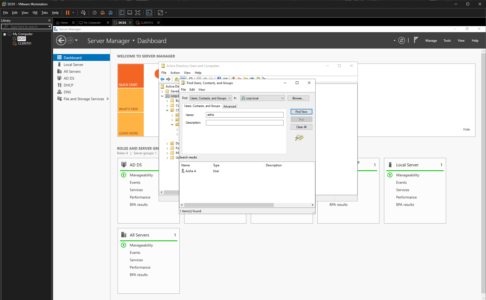
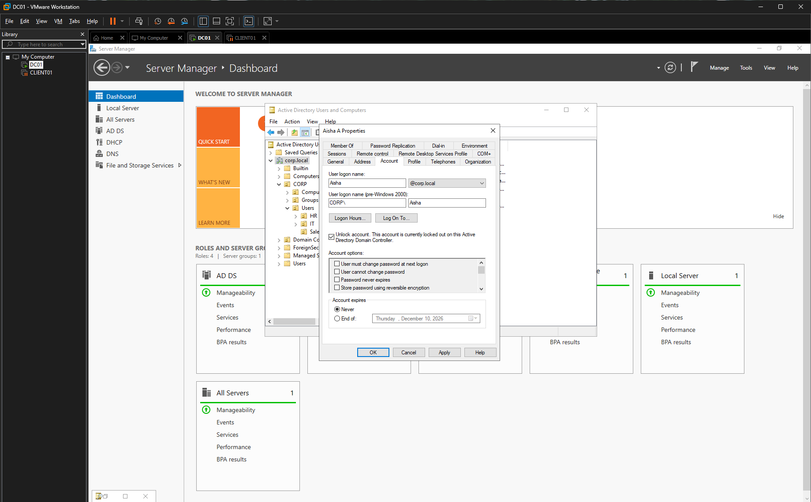
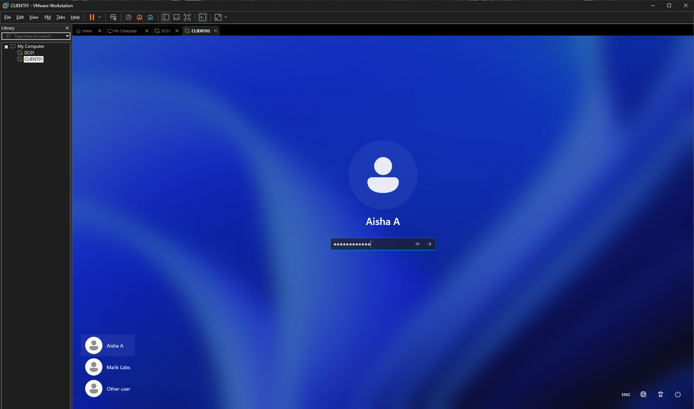
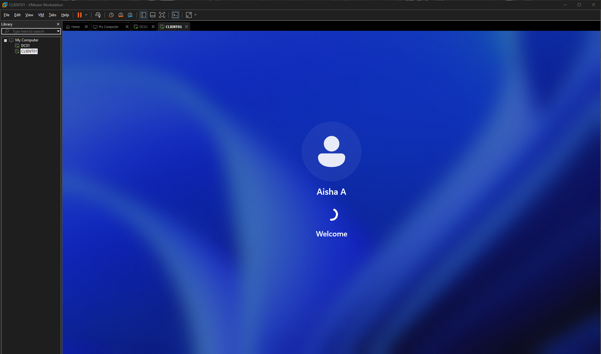
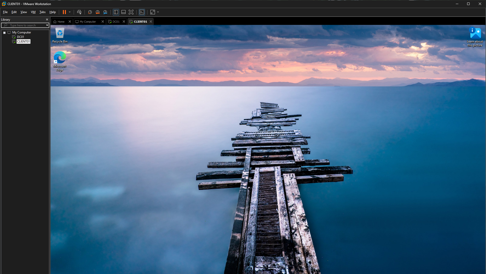
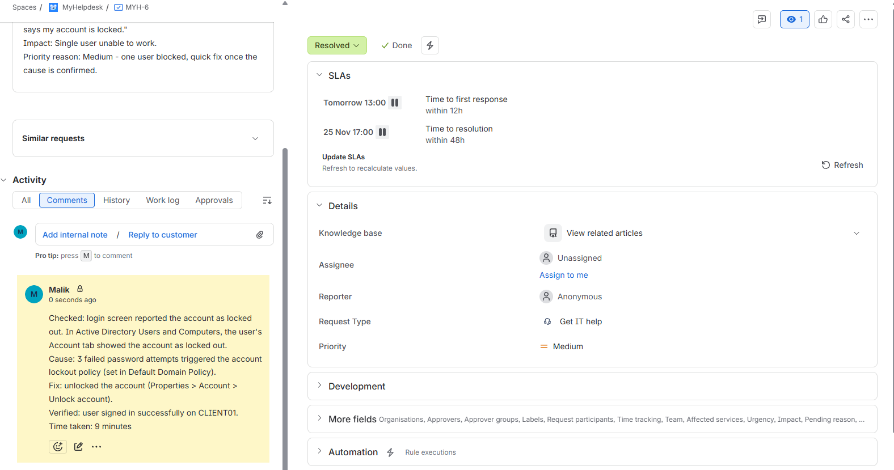

# MYH-6: Aisha A, account locked out, cannot log in

**Type:** Active Directory / Account lockout | **Priority:** Medium | **Time taken:** 9 minutes | **Status:** Resolved (Done)

**Environment:** VMware home lab, domain `corp.local`. DC01 (Windows Server 2022) and CLIENT01 (Windows 11).

## The report
Aisha A (Sales) says: *"I mistyped my password a few times and now it says my account is locked."* Device: CLIENT01. One user unable to work. Priority is Medium: one user blocked, and a quick fix once the cause is confirmed.

 Ticket as raised

## Diagnosis

**1. See what the user sees.** The sign-in screen on CLIENT01 shows "The referenced account is currently locked out and may not be logged on to." That wording is specific. A wrong password says "The password is incorrect". This message means the account itself is locked in Active Directory, so retyping the password will not help.

 Locked-out message on CLIENT01

**2. Find the account in AD.** On DC01, in Active Directory Users and Computers, used Find (Users, Contacts, and Groups) to search `aisha` in `corp.local`. One result: Aisha A.

 Find Aisha A in AD

**3. Confirm the lockout.** Opened her properties > **Account** tab. The "Unlock account" box is shown with the text "This account is currently locked out on this Active Directory Domain Controller." That confirms the cause.

## Cause
Repeated wrong passwords triggered the domain's account lockout policy, which locks an account after a set number of failed sign-ins. Her password was fine. The account was locked because of the failed attempts.

## Fix
On the Account tab, ticked **Unlock account** and clicked OK. No password reset was needed, because she knows her password.

 Unlock account ticked

## Verification
Aisha signed in again on CLIENT01. The sign-in is accepted ("Welcome") and she reaches her desktop.

 Sign-in retry

 Welcome screen

 Desktop after sign-in

## Resolution
Closed as Resolved / Done with an internal note.

 Resolved ticket

> **Internal note:** Checked: login screen reported the account as locked out. In Active Directory Users and Computers, the user's Account tab showed the account as locked out. Cause: 3 failed password attempts triggered the account lockout policy (set in Default Domain Policy). Fix: unlocked the account (Properties > Account > Unlock account). Verified: user signed in successfully on CLIENT01. Time taken: 9 minutes

## What I learned
- "Locked out" and "wrong password" are different errors with different fixes. Unlocking an account does not change the password, and resetting a password does not always unlock the account.
- Check the Account tab first. If the box is there, the account is locked.
- A lockout is often a symptom. If it keeps happening, look for a saved or old password on a phone, mapped drive or service still trying to sign in.
- Unlock for the user, but tell them not to keep retrying, which re-locks the account.

---

<a href="MYH-5_restrict-command-prompt-hr.md">← MYH-5: Restrict Command Prompt for HR (GPO)</a> &nbsp;·&nbsp; <a href="../README.md#helpdesk-tickets">All tickets</a> &nbsp;·&nbsp; <a href="MYH-7_folder-access-denied.md">MYH-7: Folder access denied →</a>

