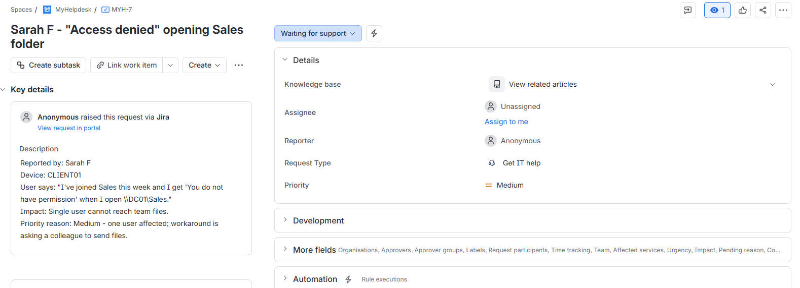
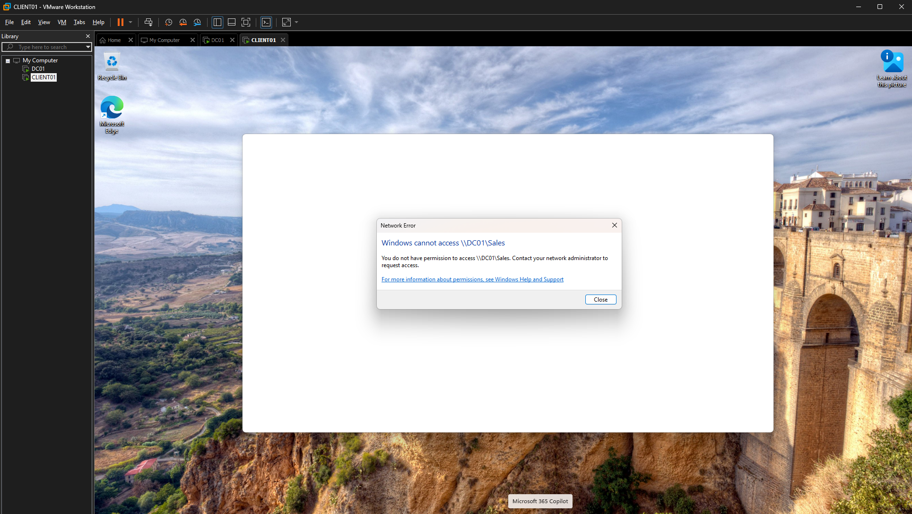
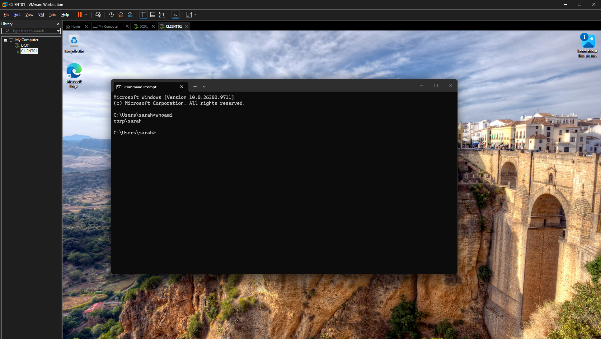
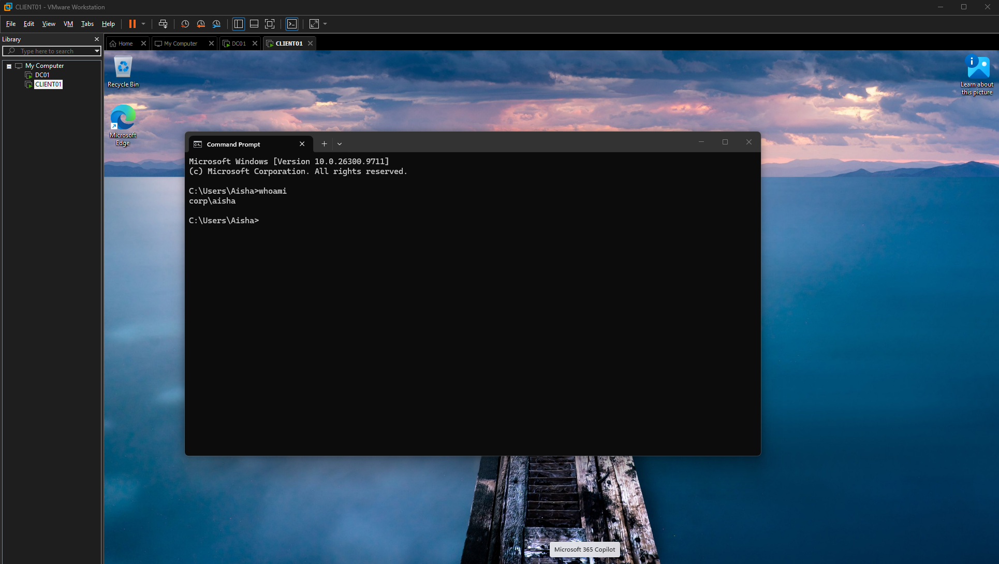
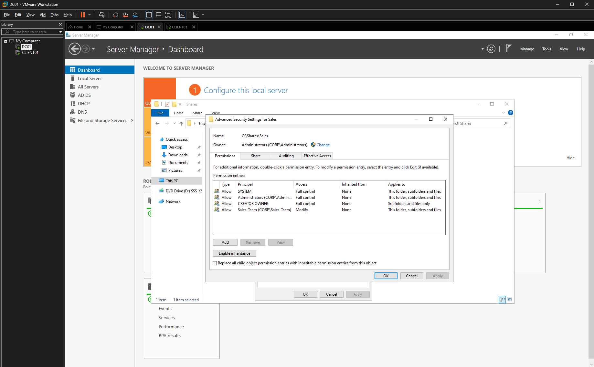
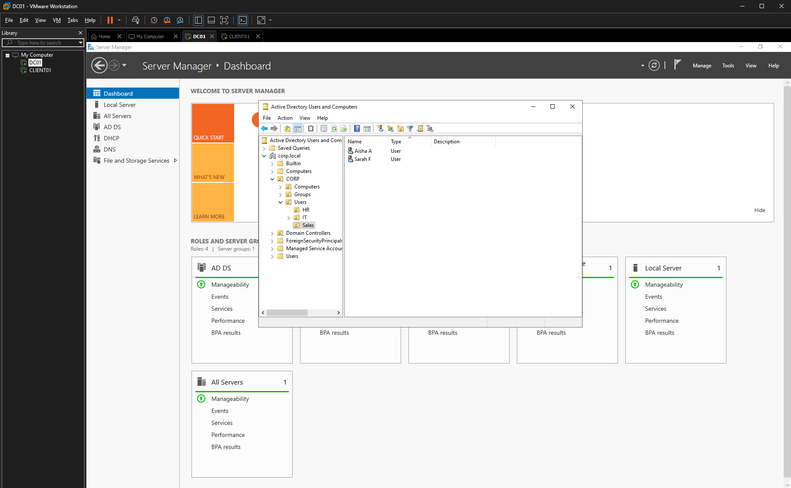
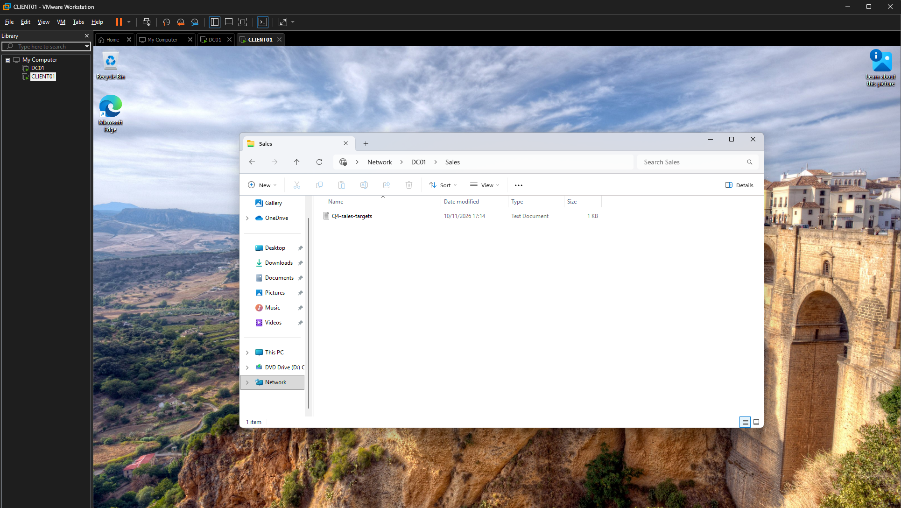
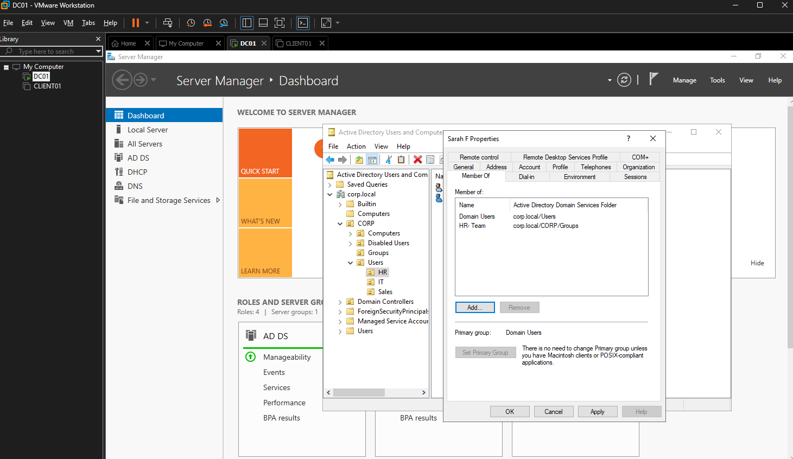
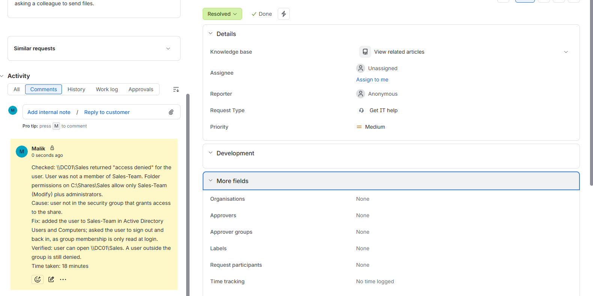

# MYH-7: Sarah F, "Access denied" opening the Sales folder

**Type:** Permissions / File share | **Priority:** Medium | **Time taken:** 18 minutes | **Status:** Resolved (Done)

**Environment:** VMware home lab, domain `corp.local`. DC01 (Windows Server 2022, file share `\\DC01\Sales`) and CLIENT01 (Windows 11).

## The report
Sarah F says: *"I've joined Sales this week and I get 'You do not have permission' when I open \\DC01\Sales."* Device: CLIENT01. One user cannot reach team files. The workaround is asking a colleague to send her files, so the priority is Medium.

 Ticket as raised

## Diagnosis

**1. Reproduce the problem as the user.** Signed in to CLIENT01 as Sarah and opened `\\DC01\Sales`. Windows shows a Network Error: "Windows cannot access \\DC01\Sales. You do not have permission to access \\DC01\Sales. Contact your network administrator to request access." The share is reachable. The server is refusing her.

 Access denied error

`whoami` confirms the session is `corp\sarah`.

 whoami as Sarah

For comparison I also signed in as an existing Sales user, Aisha A (`corp\aisha`).

 whoami as Aisha

**2. Check who the folder allows.** On DC01, `C:\Shares\Sales` > Properties > Security > Advanced shows only: SYSTEM and Administrators (Full control), CREATOR OWNER, and **Sales-Team (Modify)** on this folder, subfolders and files. There are no broad `Users` or `Everyone` entries. So the folder lets in members of the **Sales-Team** group and nobody else.

 NTFS permissions on C:\Shares\Sales

**3. Check the user.** Sarah's account is in the **Sales** OU. Per my ticket note, she was not a member of the **Sales-Team** group.

 Sarah F in the Sales OU

## Cause
The folder grants access to the Sales-Team security group. Sarah is in the Sales OU, but an OU does not grant file access. Only group membership does. She was not in Sales-Team, so the permission check failed. The error was correct, because the permissions were working as designed.

## Fix
Per my ticket note, I added Sarah F to the **Sales-Team** group in Active Directory Users and Computers and asked her to sign out and back in. Group membership is read when a user logs in, so an existing session does not see the change.

*Screenshot of the group add not captured.*

## Verification
After signing back in, `\\DC01\Sales` opens. Opening it through Network > DC01 > Sales shows the contents (`Q4-sales-targets`).

 Sales share opens

## Follow-up
Sarah was later moved to the HR team to test the permissions. Her groups are now Domain Users and HR-Team (the name shows a stray space in the screenshot). She is no longer in Sales-Team, so she no longer has access to the Sales share.

 Sarah F's groups after the move to HR

## Resolution
Closed as Resolved / Done with an internal note.

 Resolved ticket

> **Internal note:** Checked: \\DC01\Sales returned "access denied" for the user. User was not a member of Sales-Team. Folder permissions on C:\Shares\Sales allow only Sales-Team (Modify) plus administrators. Cause: user not in the security group that grants access to the share. Fix: added the user to Sales-Team in Active Directory Users and Computers; asked the user to sign out and back in, as group membership is only read at login. Verified: user can open \\DC01\Sales. A user outside the group is still denied. Time taken: 18 minutes

## What I learned
- OUs take policy. Groups grant access. Being in the Sales OU did nothing for a share that checks the Sales-Team group.
- The fix is in Active Directory, not on the folder. Changing the folder's permissions would have been the wrong fix, and would have widened access.
- Group membership is read at sign-in, so the user must sign out and back in before the change takes effect.
- Check the folder's permissions before touching anything, and keep access narrow (one group, no broad `Users` entries).

---

<a href="MYH-6_account-lockout.md">← MYH-6: Account lockout</a> &nbsp;·&nbsp; <a href="../README.md#helpdesk-tickets">All tickets</a> &nbsp;·&nbsp; <a href="MYH-8_leaver.md">MYH-8: Leaver →</a>

