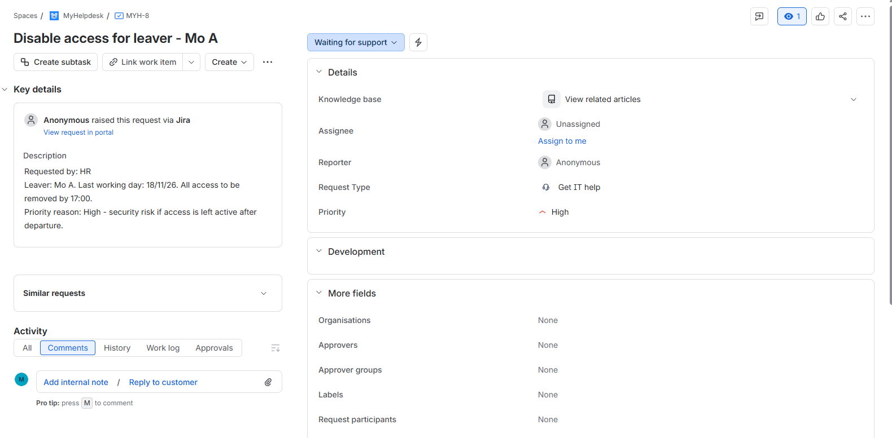
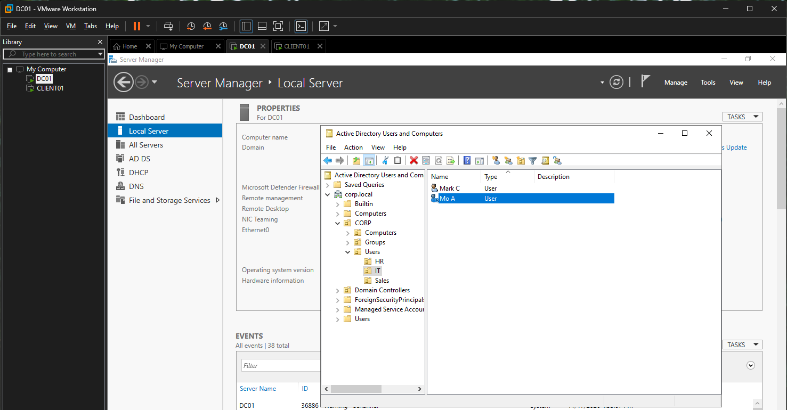
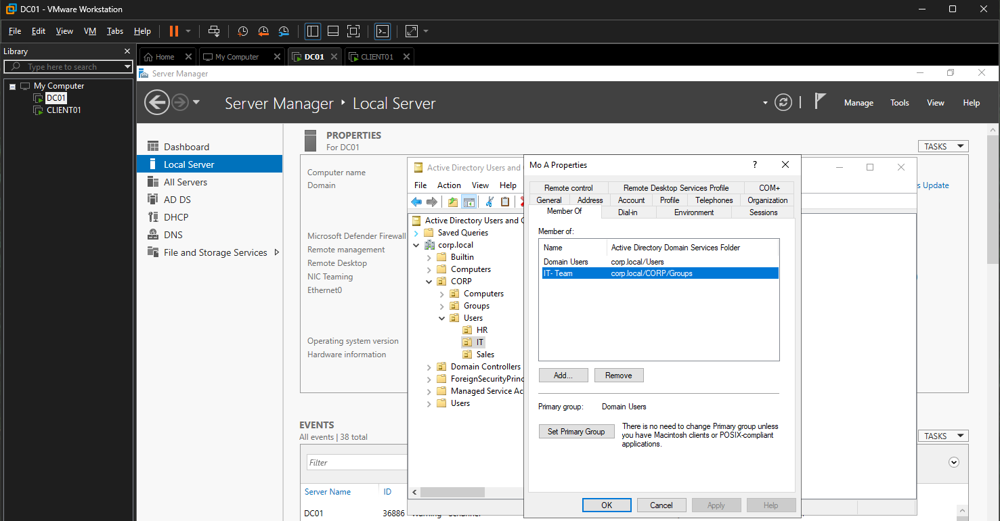
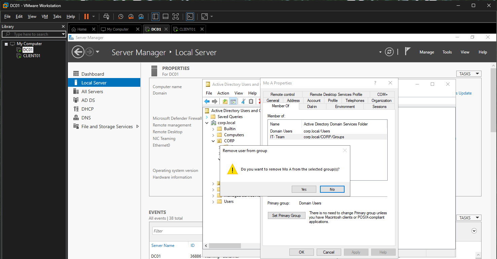
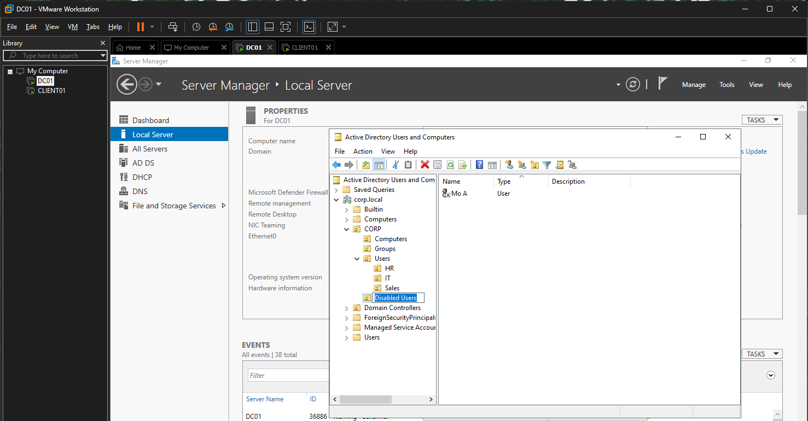
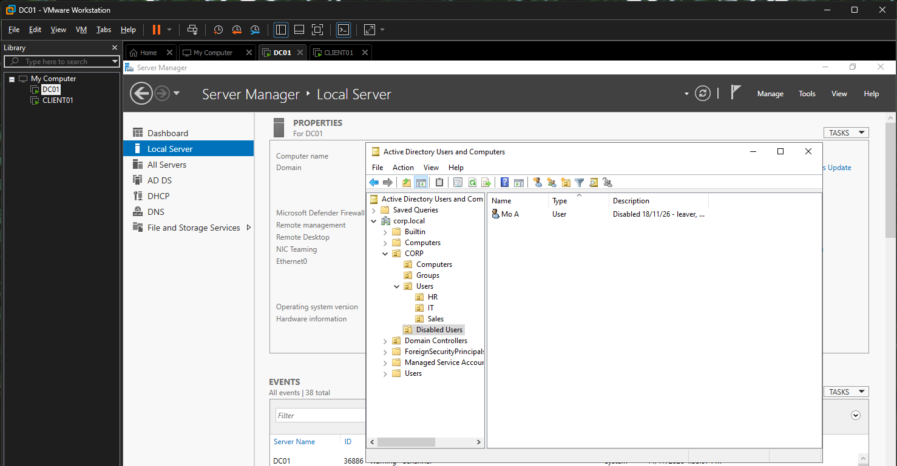
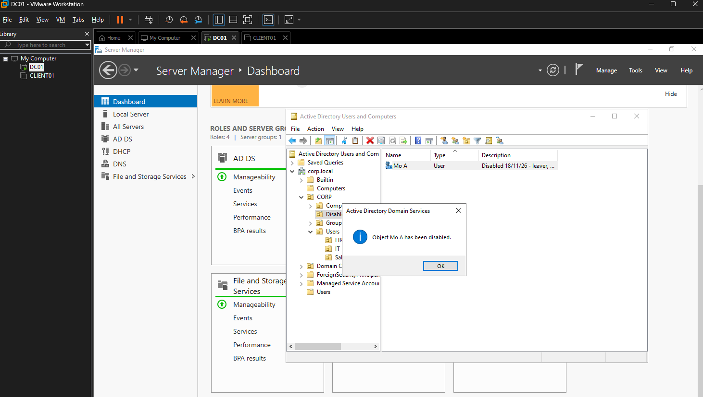
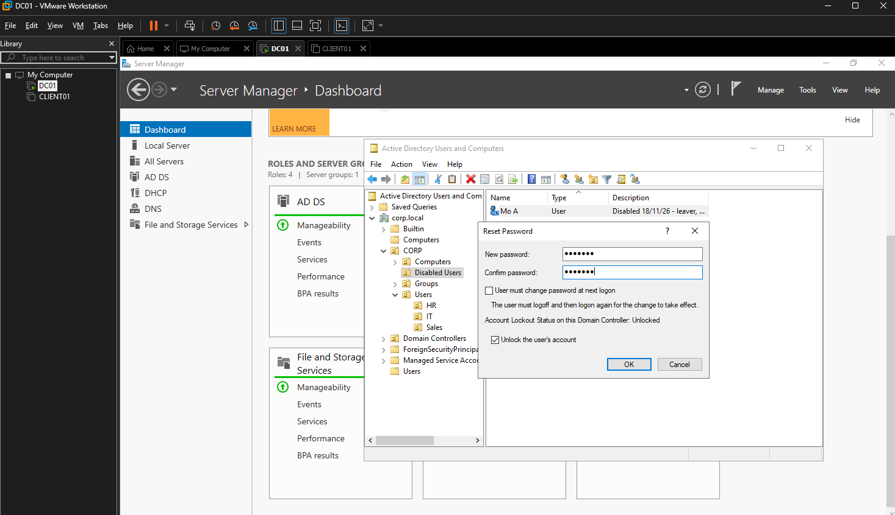
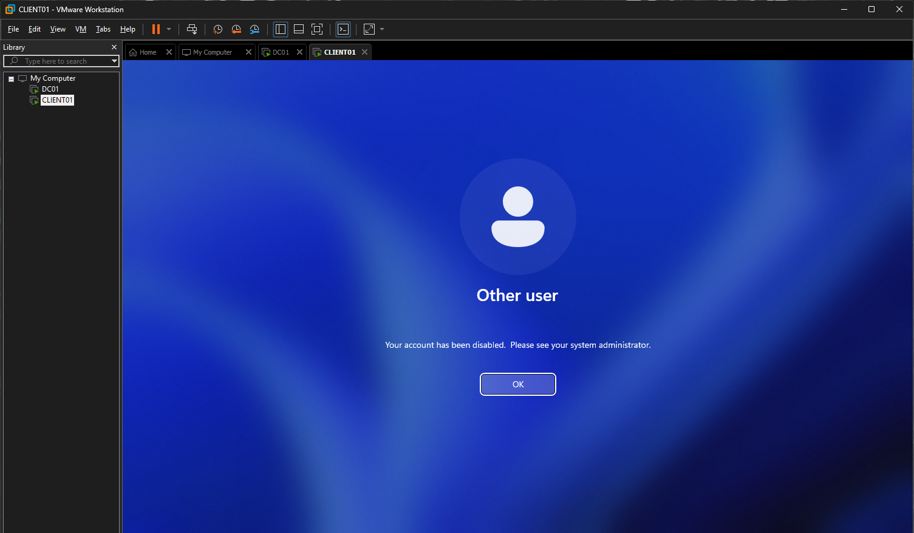
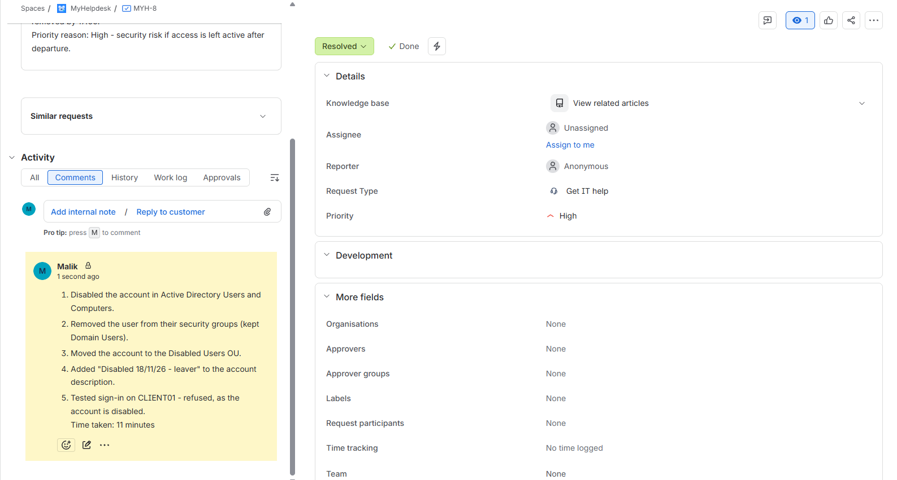

# MYH-8: Disable access for leaver, Mo A

**Type:** Offboarding / Active Directory | **Priority:** High | **Time taken:** 11 minutes | **Status:** Resolved (Done)

**Environment:** VMware home lab, domain `corp.local`. DC01 (Windows Server 2022) and CLIENT01 (Windows 11).

## The report
HR asked for access to be removed for a leaver. Mo A (IT) has a last working day of 18/11/26, and all access must be gone by 17:00. Priority is High because an active account for someone who has left is a security risk.

 Ticket as raised

## Approach
The account is **disabled, not deleted**. Disabling stops sign-in straight away but keeps the account, its history and its permissions record, so it can be audited or re-enabled if the person returns. Then remove its group memberships so nothing still grants access, reset the password, and move the account somewhere obvious so it is easy to find and review.

## What was done

**Find the account.** In Active Directory Users and Computers, Mo A is in the **IT** OU (with Mark C).

 Mo A in the IT OU

**Remove group memberships.** In Mo A's properties > **Member Of** tab, the account is in Domain Users and IT-Team. Removed **IT-Team** (confirmation: "Do you want to remove Mo A from the selected group(s)?"). Domain Users stays, because it is the primary group every domain account belongs to.

 Mo A group membership

 Confirm removal from the group

**Move the account to a Disabled Users OU.** Created a **Disabled Users** OU under CORP and moved Mo A into it, so leavers are kept apart from live users.

 Disabled Users OU created

**Record it in the description.** Added "Disabled 18/11/26 - leaver" to the account description, so anyone looking at the account later can see when and why it was disabled.

 Mo A in Disabled Users with description

**Disable the account.** Right-click the user > Disable Account. Active Directory confirms: "Object Mo A has been disabled."

 Account disabled confirmation

**Reset the password.** Reset Mo A's password to a random value, so the old password cannot be used even if the account is re-enabled by mistake.

 Reset password

## Verification
Tried to sign in on CLIENT01. Windows refuses with "Your account has been disabled. Please see your system administrator."

 Sign-in refused

## Resolution
Closed as Resolved / Done with an internal note.

 Resolved ticket

> **Internal note:** 1. Disabled the account in Active Directory Users and Computers. 2. Removed the user from their security groups (kept Domain Users). 3. Moved the account to the Disabled Users OU. 4. Added "Disabled 18/11/26 - leaver" to the account description. 5. Tested sign-in on CLIENT01 - refused, as the account is disabled. Time taken: 11 minutes

## What I learned
- Disable, don't delete. Deleting loses the audit trail and cannot be undone easily.
- Disabling stops sign-in, but group memberships still grant access (for example to shares). Removing them closes that gap.
- A Disabled Users OU and a dated description make leaver accounts easy to find and review later.
- Always test the result. Seeing the "account has been disabled" message is the proof that the job is done.
- Speed matters. HR set a 17:00 deadline, so this is a High priority ticket.

---

<a href="MYH-7_folder-access-denied.md">← MYH-7: Folder access denied</a> &nbsp;·&nbsp; <a href="../README.md#helpdesk-tickets">All tickets</a>

